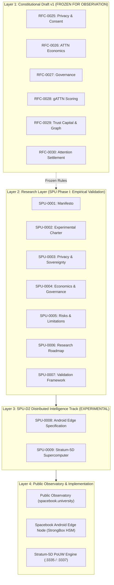

# 🎓 Spacebook.University (SPU)
### Sovereign Research Institution for Empirical Attention Governance, Personal Sovereignty & Distributed Edge Supercomputing

[](LICENSE)
[]()
[]()
[](https://spacebook.university/)

**Spacebook.University** is an open scientific research institution dedicated to the empirical measurement of decentralized attention sovereignty, contribution-based governance, and mobile edge supercomputing.

---

## 🏛️ The Four Epistemic Layers



---

## 📑 Official Research Track & Constitutional Specifications

### 🏛️ Constitutional Draft v1 (Frozen for Empirical Observation)
* **[RFC-0025: Privacy, Consent & Personal Sovereignty](docs/rfc/RFC-0025.md)**
* **[RFC-0026: Attention Economy & Token Economics](docs/rfc/RFC-0026.md)**
* **[RFC-0027: Constitution & Governance Mechanisms](docs/rfc/RFC-0027.md)**
* **[RFC-0028: gATTN Scoring & Proof-of-Competency](docs/rfc/RFC-0028.md)**
* **[RFC-0028-A: Reputation Capital Graph](docs/rfc/RFC-0028-A.md)**
* **[RFC-0029: Trust Capital & Stewardship](docs/rfc/RFC-0029.md)**
* **[RFC-0029-A: Three Capitals Topology](docs/rfc/RFC-0029-A.md)**
* **[RFC-0029-B: Topological Graph Lineage](docs/rfc/RFC-0029-B.md)**
* **[RFC-0030: Attention Sovereignty Settlement](docs/rfc/RFC-0030.md)**

### 🔬 SPU Phase I: Empirical Research Documents
* **[SPU-0001: The Spacebook Manifesto](docs/spu/SPU-0001-The-Spacebook-Manifesto.md)**
* **[SPU-0002: Spacebook University Experimental Charter](docs/spu/SPU-0002-Spacebook-University-Experimental-Charter.md)**
* **[SPU-0003: Privacy, Consent, and Personal Sovereignty](docs/spu/SPU-0003-Privacy-Consent-Personal-Sovereignty.md)**
* **[SPU-0004: Economics and Governance](docs/spu/SPU-0004-Economics-and-Governance.md)**
* **[SPU-0005: Risks, Limitations, and Open Questions](docs/spu/SPU-0005-Risks-Limitations-Open-Questions.md)**
* **[SPU-0006: Research Roadmap and Open Problems](docs/spu/SPU-0006-Research-Roadmap-Open-Problems.md)**
* **[SPU-0007: Empirical Metrics and Validation Framework](docs/spu/SPU-0007-Experimental-Metrics-Validation-Framework.md)**
* **[SPU-0008: Spacebook Mobile Edge Node Android Specification](docs/spu/SPU-0008-Spacebook-Android-App-Specification.md)**
* **[SPU-0009: Stratum-5D Distributed Supercomputer Research Track](docs/spu/SPU-0009-Distributed-Supercomputer-Stratum-5D-Research-Track.md)**
* **[Master Autodoc: Distributed Supercomputer & Android App Specification](docs/AUTODOC_SPACEBOOK_5D_DISTRIBUTED_SUPERCOMPUTER.md)**

---

## 🧪 Empirical Hypotheses & Baseline Anchor ($E_0 = 73$)

| ID | Hypothesis | Primary Metric | Target Threshold | Baseline Anchor ($E_0$) |
| :--- | :--- | :--- | :--- | :--- |
| **H-000** | **Graph Reality Alignment** | Graph Drift Index ($\text{GDI}$) | $\text{GDI} < 0.01$ | $0.000$ (Zero Drift) |
| **H-001** | **Governance Defect Resistance** | Defect Rate & Gini Coefficient | $\text{Defect} < 5.0\%$, $\text{Gini} < 0.45$ | $\text{Defect: } 0.0\%$, $\text{Gini: } 0.22$ |
| **H-002** | **Trust Predictability** | Trust Alignment Index ($\text{TAI}$) | $\text{TAI} \ge 0.95$ | $0.982$ |
| **H-003** | **Consent Preference** | Policy Customization & Revocation Latency | $\text{Custom} > 25.0\%$, $\text{Revoc} < 1000\text{ms}$ | $\text{Custom: } 100\%$, $\text{Revoc: } 85\text{ms}$ |
| **H-004** | **Distributed Compute Viability** | Mobile NPU Efficiency | $\eta \ge 12.0 \text{ tok/W}$ | $18.4 \text{ tok/W}$ |
| **H-005** | **Participant Usability & Retention** | Device Opt-Out Rate ($O_{rate}$) | $O_{rate} < 5.0\%$ | $0.0\%$ |
| **H-006** | **Graph Verification Scalability** | Subgraph Coverage & Audit Latency | Coverage $\ge 99.0\%$, Latency $\le 60\text{s}$ | $100.0\%$, $18\text{s}$ |
| **H-007** | **Federated Privacy Preservation** | Differential Privacy Budget | $\epsilon \le 1.0$, Accuracy Delta $> 0.0\%$ | $\epsilon = 0.5$, $\Delta = 10^{-5}$ |

---

## 📱 Spacebook 5D Android Edge Node (`android/`)

The official Android Edge Node turns consumer Android devices into sovereign compute participants:
* **StrongBox Hardware Security (`android/.../StrongBoxKeyManager.kt`):** Generates and holds non-exportable ECDSA P-256 (`secp256r1`) signing keys within the device's tamper-resistant hardware security module (HSM).
* **Thermal & Battery Usability Governor (`android/.../ThermalBatteryGovernor.kt`):** Automatically protects battery health by limiting duty cycles to $\le 35\%$, throttling above $36.5^\circ\text{C}$, and halting compute above $38.5^\circ\text{C}$.
* **Stratum-5D Worker Client (`android/.../Stratum5DWorkerClient.kt`):** Lightweight asynchronous socket client negotiating work shares over TCP port `3335`.
* **24/7 Foreground Service (`android/.../SpacebookEdgeService.kt`):** System service bound to notification ID `0x7300`.
* **Material3 Jetpack Compose UI (`android/.../MainActivity.kt`):** Live dashboard showing real-time compute state, thermal readings, and consent controls.

---

## ⚡ Stratum-5D PoUW Supercomputer Engine (`compute/`)

A high-performance Proof-of-Useful-Work (PoUW) pool daemon distributing neural inference slices and graph invariant checks:
* **Port Allocation Standard:**
  * `3335`: Stratum+TCP compute job distribution.
  * `3337`: HTTP metrics, diagnostics, and Public Observatory integration.
* **Deterministic Verification:** Zero-trust recomputation and dual-attestation quorum guarantee that client-submitted compute shares are strictly validated before settlement.

---

## 🚀 Getting Started & Local Development

### 1. Run the Stratum-5D Server:
```bash
python compute/stratum_5d_server.py
```

### 2. Run the Automated Integration Tests:
```bash
python compute/test_stratum_5d_server.py
```

### 3. Build the Android Edge Node:
```bash
cd android
./gradlew assembleDebug
```

---

## ⚖️ Governance & License

All scientific research and specifications are released under the **MIT License**.  
Governed under the sovereign constitutional protocol of Spacebook.University.
