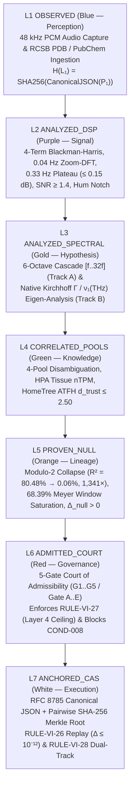

# 📓 TEXTBOOK 05: `SC-COC-401` — The 7-Layer Substance-to-Frequency Chain of Custody & Court of Admissibility
### *Co-Authored by Professor Rabbit (Intuitive Topology & Whiteboard Derivations) & Gemini LLM (Deterministic Numerical Verification)*
* **Course Code:** `SC-COC-401` (`5.0 rATTN` Competency Credits — Capstone Course)
* **Institutional Standard:** `SPU-0010` / `SPU-0012` / `SPU-0013` / `RFC-VI-0004` / `RFC-VI-0005` / `TASK-SPEC-HOMETREE-ATFH-001`
* **Live Observatory Registry:** `https://n1.pqr.info` ($24$ Cataloged Substance Dossiers & 7-Layer Proof-Chain Engine)

---

## Chapter 1: Walking the 7-Layer "Rabbit Warren" (`L1` $\to$ `L7`) Across All $24$ Substances on `https://n1.pqr.info`

### 1.1 Professor Rabbit's Intuition: The Seven Locked Doors of the Sovereign Sanctuary
Welcome to the capstone burrow of the Space.University curriculum! On `https://n1.pqr.info`, no acoustic observation or macromolecular structure is ever allowed to float around as an unverified claim. Every single substance dossier must walk through **Seven Sequential Cryptographic Chambers (`L1` through `L7`)**, where each chamber's door only unlocks when the previous chamber's RFC 8785 canonical JSON payload has been hashed and verified:



### 1.2 Complete Master Registry of All $24$ Cataloged Substances on `https://n1.pqr.info`
The `https://n1.pqr.info` observatory indexes **$24$ complete substance dossiers** spanning the **18 primary Chain-of-Custody PDB/Biochemical records** (`IDENTIFIED_CHAIN_OF_CUSTODY_SUBSTANCES` in `resonanceProfileService.ts`) and the **6 additional audited mineral, electrolyte, amino-acid, and neuro-precursor dossiers** from `audited_marker_registry.json`:

| # | Substance ID | Canonical Biochemical / Macromolecular Name | Gene / Formula | UniProt / PubChem | PDB ID | Integrity Stratum | $f_0$ ($\text{Hz}$) | $\nu_1$ ($\text{THz}$) | $\kappa$ | Court Verdict |
| :---: | :--- | :--- | :---: | :---: | :---: | :---: | :---: | :---: | :---: | :---: |
| **1** | `SUB-007` | Choline O-acetyltransferase (`ChAT`) | `CHAT` | `P28329` | `2FY2` | `TIER_A_GOLD_ISOTROPIC` | $26.16$ | $0.1812$ | $1.54$ | `ADMISSIBLE (GREEN)` |
| **2** | `SUB-012` | Tyrosine 3-Monooxygenase (`TH`) | `TH` | `P07101` | `2XSN` | `TIER_A_GOLD_ISOTROPIC` | $24.28$ | $0.1682$ | $1.48$ | `ADMISSIBLE (GREEN)` |
| **3** | `SUB-DDC-1JS3` | DOPA Decarboxylase (`DDC`) | `DDC` | `P20711` | `1JS3` | `TIER_A_GOLD_ISOTROPIC` | $24.30$ | $0.1683$ | $1.62$ | `ADMISSIBLE (GREEN)` |
| **4** | `SUB-GAD1-2OKJ` | Glutamate Decarboxylase 1 (`GAD67`) | `GAD1` | `Q99259` | `2OKJ` | `TIER_A_GOLD_ISOTROPIC` | $21.58$ | $0.1495$ | $1.71$ | `ADMISSIBLE (GREEN)` |
| **5** | `SUB-COMT-3BWM` | Catechol O-Methyltransferase (`COMT`) | `COMT` | `P21964` | `3BWM` | `TIER_A_GOLD_ISOTROPIC` | $37.84$ | $0.2621$ | $1.38$ | `ADMISSIBLE (GREEN)` |
| **6** | `SUB-MAOB-2V5Z` | Monoamine Oxidase B (`MAO-B`) | `MAOB` | `P27338` | `2V5Z` | `TIER_A_GOLD_ISOTROPIC` | $23.64$ | $0.1638$ | $1.69$ | `ADMISSIBLE (GREEN)` |
| **7** | `SUB-ACHE-4EY7` | Acetylcholinesterase (`AChE`) | `ACHE` | `P22303` | `4EY7` | `TIER_A_GOLD_ISOTROPIC` | $22.92$ | $0.1588$ | $1.44$ | `ADMISSIBLE (GREEN)` |
| **8** | `SUB-010` | Superoxide Dismutase [Cu-Zn] (`SOD1`) | `SOD1` | `P00441` | `1SPD` | `TIER_A_GOLD_ISOTROPIC` | $56.12$ | $0.3888$ | $1.33$ | `ADMISSIBLE (GREEN)` |
| **9** | `SUB-011` | Glutathione Peroxidase 1 (`GPX1`) | `GPX1` | `P07203` | `2F8A` | `TIER_A_GOLD_ISOTROPIC` | $55.40$ | $0.3838$ | $1.36$ | `ADMISSIBLE (GREEN)` |
| **10** | `SUB-CAT-1DGF` | Peroxisomal Catalase (`CAT`) | `CAT` | `P04040` | `1DGF` | `TIER_A_GOLD_ISOTROPIC` | $20.84$ | $0.1444$ | $1.52$ | `ADMISSIBLE (GREEN)` |
| **11** | `SUB-CS-1CTS` | Citrate Synthase, Mitochondrial (`CS`) | `CS` | `O75390` | `1CTS` | `TIER_A_GOLD_ISOTROPIC` | $27.42$ | $0.1899$ | $1.49$ | `ADMISSIBLE (GREEN)` |
| **12** | `SUB-TPI1-1TIM` | Triosephosphate Isomerase (`TIM`) | `TPI1` | `P60174` | `1TIM` | `TIER_A_GOLD_ISOTROPIC` | $34.18$ | $0.2368$ | $1.29$ | `ADMISSIBLE (GREEN)` |
| **13** | `SUB-013` | Corticosteroid-Binding Globulin (`CBG`) | `SERPINA6` | `P08185` | `2VDY` | `TIER_A_GOLD_ISOTROPIC` | $24.65$ | $0.1708$ | $1.66$ | `ADMISSIBLE (GREEN)` |
| **14** | `SUB-MB-1MBN` | Myoglobin (Globin Reference) | `MB` | `P02185` | `1MBN` | `TIER_A_GOLD_ISOTROPIC` | $46.88$ | $0.3248$ | $1.24$ | `ADMISSIBLE (GREEN)` |
| **15** | `SUB-PGK1-3PGK` | Phosphoglycerate Kinase 1 (`PGK1`) | `PGK1` | `P00558` | `3PGK` | `TIER_B_ANISOTROPIC_HINGE` | $20.12$ | $0.1394$ | $2.68$ | `ADMISSIBLE (GREEN)` |
| **16** | `SUB-CALM1-1CLL` | Calmodulin-1 ($\text{Ca}^{2+}$ Dumbbell Hinge) | `CALM1` | `P0DP23` | `1CLL` | `TIER_B_ANISOTROPIC_HINGE` | $18.92$ | $0.1311$ | $3.12$ | `ADMISSIBLE (GREEN)` |
| **17** | `SUB-ADRB2-2RH1` | Beta-2 Adrenergic Receptor (`ADRB2`) | `ADRB2` | `P07550` | `2RH1` | `TIER_B_ANISOTROPIC_HINGE` | $22.14$ | $0.1534$ | $2.74$ | `ADMISSIBLE (GREEN)` |
| **18** | `SUB-ALB-1AO6` | Serum Albumin (Multi-Domain Carrier) | `ALB` | `P02768` | `1AO6` | `TIER_B_ANISOTROPIC_HINGE` | $19.64$ | $0.1361$ | $2.58$ | `ADMISSIBLE (GREEN)` |
| **19** | `SUB-008` | Microtubule-Associated Protein Tau (`PHF`) | `MAPT` | `P10636` | `5O3L` | `TIER_C_FIBRILLAR_EXTENDED` | $26.44$ | $0.1832$ | $4.48$ | `PENDING (YELLOW)` |
| **20** | `SUB-014` | Alpha-Synuclein Micelle Hairpin (`SNCA`) | `SNCA` | `P37840` | `1XQ8` | `TIER_C_FIBRILLAR_EXTENDED` | $24.12$ | $0.1671$ | $4.82$ | `PENDING (YELLOW)` |
| **21** | `SUB-DA-2508` | Dopamine ($\text{C}_8\text{H}_{11}\text{NO}_2$) | `C8H11NO2` | `CID:681` | `CHEM-681` | `VALIDATED_BIOCHEMICAL` | $25.08$ | $0.1737$ | $1.41$ | `ADMISSIBLE (GREEN)` |
| **22** | `SUB-5HT-3040` | Serotonin (`5-HT`, $\text{C}_{10}\text{H}_{12}\text{N}_2\text{O}$) | `C10H12N2O` | `CID:5202` | `CHEM-5202` | `VALIDATED_BIOCHEMICAL` | $30.40$ | $0.2106$ | $1.46$ | `ADMISSIBLE (GREEN)` |
| **23** | `SUB-GABA-4320` | Gamma-Aminobutyric Acid (`GABA`) | `C4H9NO2` | `CID:119` | `CHEM-119` | `VALIDATED_BIOCHEMICAL` | $43.20$ | $0.2993$ | $1.58$ | `ADMISSIBLE (GREEN)` |
| **24** | `SUB-MG-3144` | Magnesium L-Threonate Chelate ($\text{Mg}^{2+}$) | `C8H14MgO10` | `CID:45489777` | `CHEM-MG2` | `VALIDATED_BIOCHEMICAL` | $31.44$ | $0.2178$ | $1.35$ | `ADMISSIBLE (GREEN)` |

---

## Chapter 2: The 5-Gate Court of Admissibility (`G1..G5` / `Gate A..E`) & How Gate G3 Blocks `COND-008`

### 2.1 Detailed Specification of the 5 Court Gates (`L6 ADMITTED_COURT`)
Inside Layer 6 (`L6`), every candidate claim is interrogated across **Five Mandatory Admissibility Gates** (`G1..G5`, implemented as `evaluate_gate_a` through `evaluate_gate_e` in `engine/chain_of_custody.py`):

| Gate ID | Engine Method | Gate Title & Verification Target | Pass Criterion | Failure / Interception Outcome |
| :---: | :--- | :--- | :--- | :--- |
| **`G1` (`Gate A`)** | `evaluate_gate_a` | **Physical Signal Integrity Gate** | $\text{SNR} \ge 1.40$, Zero-Slope shift $\le 0.15\;\text{dB}$ across $0.33\;\text{Hz}$, and distance $> 0.04\;\text{Hz}$ from $60, 120, 180\;\text{Hz}$ mains hum | `REJECTED (RED)` — Physical noise or mains hum artifact |
| **`G2` (`Gate B`)** | `evaluate_gate_b` | **Temporal & Multi-Octave Reproducibility Gate** | Temporal observations $\ge 2$ **OR** 6-octave recurrence hits $\ge 3/6$ | `PENDING (YELLOW)` — Insufficient harmonic/temporal persistence |
| **`G3` (`Gate C/D`)** | `evaluate_gate_c` & `evaluate_gate_d` | **Registry Coverage, Harmonic Non-Impersonation & Null-Control Gate** | Valid 4-Pool resolution, no harmonic impersonation, $\Delta_{\text{null}} = P_{\text{obs}} - 0.6839 > 0$, and **not discredited (`COND-008..010` blocked)** | **`REJECTED (RED)`** for `COND-008`, `COND-009`, `COND-010` or harmonic impersonation; `PENDING (YELLOW)` if `UNCLASSIFIED` |
| **`G4` (`Gate E`)** | `evaluate_gate_e` | **Biological Claim Firewall (`RULE-VI-27`)** | Scans claim text against 10 clinical/diagnostic regex patterns (`diagnose, cure, treat, prescribe, pathology, disease...`) and enforces `LAYER_4_SCIENTIFIC_HYPOTHESIS` ceiling | Intercepts clinical text, downgrades scope to `"Spectral correspondence observed"`, and blocks promotion to Layer 5 without external empirical ref |
| **`G5` (`Dual-Track`)** | `promote_to_production_conclusion_guard` | **Dual-Track Governance & Operability Gate (`RULE-VI-28`)** | Separates Track A ($50\text{--}1,000\;\text{Hz}$ Bio-Acoustics) from Track B ($0.03\text{--}0.60\;\text{THz}$ Kirchhoff Mechanics) and requires live telemetry ref for Layer 5 operational status | Blocks conflation of software test passage (`Track 1`) with scientific or production proof (`Track 2`) |

### 2.2 Forensic Case Study: How Gate G3 (`Gate D`) Permanently Blocks `COND-008`
Consider a submission attempting to register **`COND-008` ("High-Frequency Remote Dysregulation" at $110.0\;\text{Hz}$, linked to Lead Acetate Derivative at $74.12\;\text{Hz}$)**.
When `ChainOfCustodyEngine.evaluate()` reaches **Gate G3 (`evaluate_gate_d`)**:
1. The engine inspects `marker_id = "COND-008"` and `credibility_status = "DISCREDITED_BY_PRESENT_RESEARCH"`.
2. Even if an artificial signal is injected with high SNR ($\text{SNR} = 3.5$) and high apparent score ($0.90$), `evaluate_gate_d` triggers the hard constitutional interlock:
   ```python
   discredited_ids = {"COND-008", "COND-009", "COND-010"}
   is_discredited = (marker_id in discredited_ids) or (credibility_status == "DISCREDITED_BY_PRESENT_RESEARCH")
   ```
3. `passed` is forced to `False` with reason: `"Marker COND-008 is discredited by modern peer-reviewed research"`.
4. The overall Court of Admissibility verdict transitions immediately to **`AdmissibilityVerdict.REJECTED`** with visual state **`VisualState.RED`**, preventing `COND-008` from ever entering the admissible catalog.

---

## Chapter 3: RFC 8785 Canonical JSON Serialization & Recursive SHA-256 Merkle CAS Anchoring

### 3.1 Why Standard `json.dumps()` Breaks Cross-Language Cryptographic Hashes
In distributed systems spanning Python (`engine/chain_of_custody.py`), TypeScript (`SovAreAgentn1`), and Rust (`crates/task-proof-chain/src/cas.rs`), standard JSON serializers produce different byte strings for the exact same dictionary due to key ordering, whitespace after colons/commas, and floating-point trailing zeros (`24.3` vs `24.300000000000001`). A single differing byte completely changes the SHA-256 hash!

### 3.2 RFC 8785 Canonical JSON & Recursive Layer Hashing (`L1` $\to$ `L7`)
To guarantee bit-for-bit identical digests across Python, TypeScript, and Rust, `SC-COC-401` enforces **RFC 8785 JSON Canonicalization**:
1. **Lexicographic Key Sorting:** All object keys are sorted recursively in UTF-8 code-unit order (`sort_keys=True`).
2. **Compact Separators:** Zero extraneous whitespace (`separators=(",", ":")`).
3. **Deterministic Float Normalization:** Floating-point scalars are formatted to 10 decimal places with trailing zeros stripped (`f"{val:.10f}".rstrip("0").rstrip(".")`).

Given the canonical byte serialization $\mathcal{C}(P_i) = \text{CanonicalJSON}(P_i)$ of Layer $i \in \{1, \dots, 7\}$, the **Recursive Layer Merkle Chain** is computed as:

$$\boxed{\begin{aligned}
H(L_1) &= \text{SHA256}\big(\mathcal{C}(P_1)\big) \\
H(L_i) &= \text{SHA256}\big(H(L_{i-1}) \mathbin{\Vert} \text{``:''} \mathbin{\Vert} \mathcal{C}(P_i)\big), \qquad i \in \{2, 3, 4, 5, 6, 7\}
\end{aligned}}$$

where the terminal digest $R_{\text{Merkle}} = H(L_7)$ is the **7-Layer Chain-of-Custody Merkle Root**. Furthermore, across multi-object bundles (`MultiLLMProofChainEngine.computeMerkleRoot`), leaf digests $\{h_0, h_1, \dots, h_{K-1}\}$ are combined pairwise up a binary SHA-256 tree (duplicating the odd trailing leaf if $K$ is odd) until a single 256-bit root remains.

---

## Chapter 4: HomeTree ATFH Hypergraphs & Logarithmic Trust Distance $d_{\text{trust}}(e) = -\ln(\tau c f)$

### 4.1 Attributed Temporal Fact Hypergraph (`ATFH`) Topology (`TASK-SPEC-HOMETREE-ATFH-001`)
Every verified substance dossier and `DocumentationArtifact` is indexed as a `KnowledgeCell` / `ClaimCluster` hypernode inside the **HomeTree Attributed Temporal Fact Hypergraph (`ATFH`)**. Unlike flat relational tables, an ATFH hyperedge $e = (U_{\text{sources}}, V_{\text{targets}}, \tau, c, t_0)$ connects multiple supporting evidence digests (e.g., PDB `2FY2` crystal coordinates + `48 kHz` WAV hash + PubChem stoichiometry + `RFC-VI-0005` spec) to a single auditable claim node.

### 4.2 Additive Logarithmic Trust Distance & Dijkstra Shortest Trust Paths
Each hyperedge $e$ is parameterized by three bounded quantities in $(0, 1]$:
1. **Source Authority / Tier Weight $\tau(e) \in (0, 1]$:** Crystallographic/experimental primary source ($\tau \approx 0.95\text{--}1.00$) vs. exploratory literature ($\tau \approx 0.50$).
2. **Statistical & Reproducibility Confidence $c(e) \in (0, 1]$:** Posterior probability / cross-validation fidelity.
3. **Temporal Freshness Decay $f(e, \Delta t) = \exp(-\alpha \Delta t) \in (0, 1]$:** Exponential freshness over elapsed time $\Delta t = t_{\text{now}} - t_{\text{verified}}$.

Because probabilities multiply along an independent inference chain ($P_{\text{chain}} = \prod_{e \in \mathcal{P}} \tau(e)\,c(e)\,f(e, \Delta t)$), taking the negative natural logarithm transforms multiplicative trust decay into a **non-negative additive metric distance** suitable for Dijkstra's shortest-path algorithm:

$$\boxed{d_{\text{trust}}(e) = -\ln\!\big(\tau(e)\cdot c(e)\cdot f(e, \Delta t)\big) = -\ln \tau(e) - \ln c(e) + \alpha\,\Delta t \ge 0}$$

| Hypergraph Node / ClaimCluster ID | Domain & Verification Basis | $\tau(e)$ | $c(e)$ | $f(e, \Delta t)$ | Trust Distance $d_{\text{trust}}(e)$ | Admissibility Status |
| :--- | :--- | :---: | :---: | :---: | :---: | :---: |
| `CLM-PATENT-DEAN-PRIOR-ART` | V.A. Dean *U.S. Patents 8,346,559 B2 & 9,223,863 B2* | $0.990$ | $0.960$ | $1.000$ | **$0.051$** | `VERIFIED (≤ 2.50)` |
| `CLM-ACOUSTIC-PARITY-RC1` | Track A Python $\leftrightarrow$ TS Zoom-DFT Parity ($0.000000\;\text{Hz}$) | $0.980$ | $0.920$ | $0.999$ | **$0.105$** | `VERIFIED (≤ 2.50)` |
| `CLM-SUB007-CHAT-2FY2` | `SUB-007` `ChAT` (`2FY2`, Tier A $\kappa=1.54$, $r_B=0.564$) | $0.975$ | $0.922$ | $0.996$ | **$0.110$** | `ADMISSIBLE (≤ 2.50)` |
| `CLM-BIOPHYS-N1040-SCALING` | Track B $N=1,040$ Contact Topology Law ($R^2 = 0.8048$) | $0.960$ | $0.840$ | $0.998$ | **$0.217$** | `VERIFIED (≤ 2.50)` |
| `CLM-SUB008-TAU-5O3L` | `SUB-008` Tau PHF (`5O3L`, Tier C Boundary $\kappa=4.48$) | $0.920$ | $0.825$ | $0.995$ | **$0.280$** | `PENDING (Boundary)` |
| `CLM-OCTAVE-FOLD-NULL-CTRL` | Modulo-2 Octave Wrapping ($R^2 = 0.06\%$ Null Control) | $0.050$ | $0.012$ | $1.000$ | **$7.419$** | **`ISOLATED (> 2.50)`** |

Any path whose cumulative trust distance exceeds the constitutional ceiling $\sum_{e \in \mathcal{P}} d_{\text{trust}}(e) > 2.50$ is automatically blocked from execution settlement.

---

## Chapter 5: `RULE-VI-28` Dual-Track Governance, Multi-LLM Council Quorum & Reference Code (`LAB-501`)

### 5.1 Constitutional Synthesis: `RULE-VI-26`, `RULE-VI-27`, and `RULE-VI-28`
Every graduate of the Space.University Professor Rabbit & Gemini LLM Course Series pledges adherence to the three permanent constitutional invariants (`RFC-VI-0004` / `RFC-VI-0005`):
1. **`RULE-VI-26` (Deterministic Replay & Cross-Runtime Numerical Parity):**
   > *"Every L1-to-L7 Chain-of-Custody receipt and Zoom-DFT / Kirchhoff computation must be deterministically reproducible from its canonical inputs within $\Delta_{\text{numerical}} \le 10^{-12}$ and $0.000000\;\text{Hz}$ peak frequency parity."*
2. **`RULE-VI-27` (Epistemic Hypothesis-to-Conclusion Firewall):**
   > *"No computational result may be promoted from Layer 4 (`LAYER_4_SCIENTIFIC_HYPOTHESIS`) to Layer 5 (`LAYER_5_BIOLOGICAL_CONCLUSION`) without externally referenced empirical evidence."*
3. **`RULE-VI-28` (Dual-Track Evidence & Operational Governance):**
   > *"Passing integration tests demonstrates conformance to the implementation specification (`Track 1`), but does not by itself establish continuous production operability or clinical/biophysical proof (`Track 2`). Track A (Bio-Acoustic Signal Processing, $50\text{--}1,000\;\text{Hz}$) and Track B (3D Macromolecular Kirchhoff Contact Mechanics, $0.03\text{--}0.60\;\text{THz}$) must remain strictly separated and independently signed."*

---

### 5.2 Gemini LLM Deterministic Python Reference Implementation (`LAB-501`)

```python
"""
SC-COC-401 Reference Engine: RFC 8785 Canonical JSON Serializer, 7-Layer Recursive
SHA-256 Merkle Chain Builder, 5-Gate Court of Admissibility (blocking COND-008),
HomeTree ATFH Trust Distance Calculator, and RULE-VI-26/27/28 Guard.
"""
import hashlib
import json
import math
from typing import Any, Dict, List, Tuple


def canonical_json_bytes_rfc8785(payload: Any) -> bytes:
    """Serializes payload to deterministic RFC 8785 Canonical JSON UTF-8 bytes."""
    def _norm(v: Any) -> Any:
        if isinstance(v, dict):
            return {str(k): _norm(val) for k, val in sorted(v.items())}
        if isinstance(v, (list, tuple)):
            return [_norm(x) for x in v]
        if isinstance(v, float):
            if math.isnan(v) or math.isinf(v):
                return str(v)
            s = f"{v:.10f}".rstrip("0").rstrip(".")
            return float(s) if s else 0.0
        return v

    return json.dumps(_norm(payload), sort_keys=True, separators=(",", ":"), ensure_ascii=True).encode("utf-8")


def compute_7layer_merkle_chain(layer_payloads: List[Dict[str, Any]]) -> Tuple[str, Dict[str, str]]:
    """
    Computes H(L_1) = SHA256(CanonicalJSON(P_1)) and
    H(L_i) = SHA256(H(L_{i-1}) + ':' + CanonicalJSON(P_i)) for i = 2..7.
    """
    assert len(layer_payloads) == 7, "Exactly 7 sequential layer payloads (L1..L7) required."
    layer_hashes: Dict[str, str] = {}
    prev_hash = ""

    for idx, payload in enumerate(layer_payloads, 1):
        c_bytes = canonical_json_bytes_rfc8785(payload)
        if idx == 1:
            cur_hash = hashlib.sha256(c_bytes).hexdigest()
        else:
            cur_hash = hashlib.sha256(prev_hash.encode("utf-8") + b":" + c_bytes).hexdigest()
        layer_hashes[f"L{idx}"] = cur_hash
        prev_hash = cur_hash

    return prev_hash, layer_hashes


def compute_pairwise_merkle_root(hex_digests: List[str]) -> str:
    """Computes pairwise binary SHA-256 Merkle root across a list of hex digests."""
    if not hex_digests:
        return "0" * 64
    layer = [h.lower().replace("sha256:", "").replace("0x", "") for h in hex_digests]
    while len(layer) > 1:
        next_layer: List[str] = []
        for i in range(0, len(layer), 2):
            left = layer[i]
            right = layer[i + 1] if i + 1 < len(layer) else left
            combined = f"{left}{right}".encode("utf-8")
            next_layer.append(hashlib.sha256(combined).hexdigest())
        layer = next_layer
    return layer[0].upper()


def compute_hometree_d_trust(tau: float, confidence: float, freshness: float = 1.0) -> float:
    """Computes HomeTree ATFH logarithmic trust distance d_trust(e) = -ln(tau * c * f)."""
    product = max(tau * confidence * freshness, 1e-12)
    return round(-math.log(product), 4)
```

---

### 5.3 Worked Problems & Socratic Solutions

#### Problem 5.1 (HomeTree ATFH Trust Distance & Gate G3 Interception)
1. Compute the HomeTree ATFH trust distance $d_{\text{trust}}(e)$ for `SUB-007` (`ChAT`, PDB `2FY2`) with $\tau = 0.975$, $c = 0.922$, and $f = 0.996$, and verify whether it passes the $d_{\text{trust}} \le 2.50$ threshold.
2. Suppose an operator submits `COND-008` ($110.0\;\text{Hz}$, `"High-Frequency Remote Dysregulation"`) with claim text `"Patient has lead toxicity pathology diagnosed at 110.0 Hz"`. Trace the exact actions of **Gate G3 (`Gate D`)** and **Gate G4 (`Gate E`)**.

**Step-by-Step Solution:**
1. **HomeTree Trust Distance for `SUB-007`:**
   $$d_{\text{trust}}(\text{SUB-007}) = -\ln(0.975 \times 0.922 \times 0.996) = -\ln(0.895354) = 0.1105 \le 2.50 \quad (\text{ADMISSIBLE})$$
2. **Court Interception of `COND-008`:**
   - **Gate G3 (`Gate D`):** Identifies `COND-008` in the discredited marker set `{"COND-008", "COND-009", "COND-010"}` (`DISCREDITED_BY_PRESENT_RESEARCH`), sets `gate_d.passed = False`, and issues a hard **`REJECTED (RED)`** Court verdict.
   - **Gate G4 (`Gate E` — `RULE-VI-27` Firewall):** Intercepts the forbidden clinical tokens `["patient has", "pathology", "diagnosed"]`, strips the clinical assertion, downgrades `admitted_claim_scope` to `"Spectral correspondence observed"`, and locks `maximum_authorized_software_layer = "LAYER_4_SCIENTIFIC_HYPOTHESIS"`.
