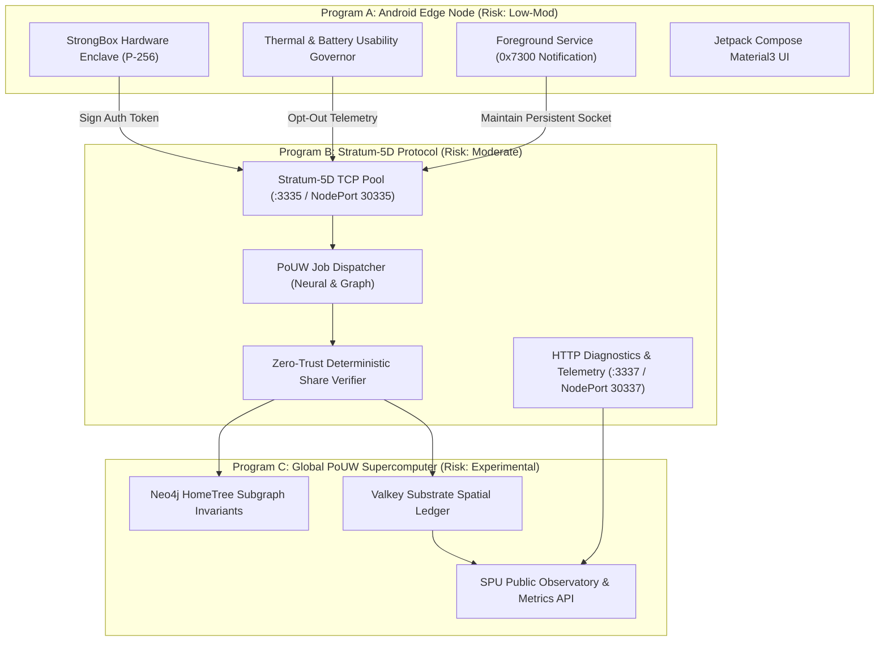

# 🦁 Spacebook 5D: Distributed Supercomputer & Android Edge Node (Autodoc)

**Protocol Specification & Architectural Master Standard**  
**Version:** 1.0.0-PROPOSED (SPU-D2 Distributed Intelligence Track)  
**Constitutional Status:** Experimental Research Track (RFC-0025 through RFC-0030 Frozen Baseline)  
**Epoch Baseline Anchor:** $E_0 = \text{Epoch } 73$  

---

## 🏛️ Executive Summary

Spacebook 5D unifies a **24/7 Mobile Edge Node** with the **Stratum-5D Distributed Compute Protocol**, creating a global, decentralized Proof-of-Useful-Work (PoUW) supercomputer. Built under the principles of **Personal Sovereignty**, **Informed Consent**, and **Zero-Trust Verification**, the system transforms idle mobile NPU (Neural Processing Unit) hardware into a resilient compute mesh capable of:
1. Distributed Neural Inference (Gemma 4 / Gemma 3 quantized edge slices).
2. Neo4j HomeTree Knowledge Graph Invariant Verification.
3. Federated Training with $(\epsilon, \delta)$-Differential Privacy aggregation.

In accordance with scientific peer review and the constitutional boundary invariant, **Stratum-5D and the distributed supercomputer operate strictly as an experimental laboratory research track under Division 2 (SPU-D2: Distributed Intelligence)**. The constitutional layer (**Constitutional Draft v1: RFC-0025 through RFC-0030**) remains strictly frozen for empirical observation, ensuring *architecture never outpacing evidence*.

---

## 🧭 Architectural Tri-Partite Decoupling



---

## 🌐 Master Port Allocation Standard

To eliminate port collision across nodes and environments, the Stratum-5D supercomputer adheres to the ratified Master Port Allocation standard:

| Port | Protocol | Service / Function | Cluster Mapping |
| :--- | :--- | :--- | :--- |
| **`3334`** | TCP / Raw | Dean Acoustic Diagnostics & Legacy Ingress | NodePort `30334` |
| **`3335`** | Stratum+TCP | **Stratum-5D Distributed Compute Work Pool** | NodePort `30335` |
| **`3336`** | QUIC / UDP | Stratum-5D Low-Latency Mobile Multiplex | NodePort `30336` |
| **`3337`** | HTTP / REST | **Metrics, Diagnostics & Observatory Ingress** | NodePort `30337` |
| **`3338`** | TCP / Experimental | Canary & Evolutionary Protocol Testing | NodePort `30338` |

---

## 📱 Spacebook Android Edge Node (`apps/spacebook-android/`)

### 1. Hardware Security Enclave (`StrongBoxKeyManager.kt`)
The Android client utilizes Android's hardware-backed **StrongBox KeyStore** to isolate cryptographic identity from the operating system:
* **Key Algorithm:** `EC` (Elliptic Curve), curve `secp256r1` (NIST P-256).
* **Purposes:** `PURPOSE_SIGN` and `PURPOSE_VERIFY`.
* **Digest:** `DIGEST_SHA256`.
* **Hardware Isolation:** `setIsStrongBoxBacked(true)` enforces non-exportable hardware storage within the tamper-resistant hardware security module (HSM).
* **Attestation:** Generates a deterministic device ID `node-strongbox-<hash>` and signs all Stratum-5D authorization requests without exposing private keys.

### 2. Thermal & Battery Usability Governor (`ThermalBatteryGovernor.kt`)
Guarantees participant device health and enforces **Hypothesis H-005 (Participant Experience Invariant)**:
* **Thermal Throttling:** Pauses execution if battery temperature exceeds **$38.5^\circ\text{C}$**; throttles if temperature exceeds **$36.5^\circ\text{C}$**.
* **Battery Discharge Protection:** Compute is permitted only when connected to AC/Wireless power or battery level $> 60\%$. Immediately halts if battery falls below $20\%$.
* **Adaptive NPU Duty Cycles:** Calculates sleep delays dynamically to limit duty cycles to $\le 35\%$, keeping battery consumption below $3.5\%/\text{hr}$.
* **Device Opt-Out Metric ($O_{rate}$):** Formally tracks user-initiated pauses and thermal halts to maintain $O_{rate} < 5.0\%$.

### 3. Background Execution Engine (`SpacebookEdgeService.kt`)
* **Foreground Service Type:** Bound to Android 14+ `FOREGROUND_SERVICE_TYPE_DATA_SYNC` / `SPECIAL_USE`.
* **Notification Channel:** `spacebook_edge_channel` with notification ID `0x7300`.
* **State Machine:** Autonomous connection, exponential backoff reconnect, job fetching, deterministic hashing, and telemetry reporting.

---

## ⚡ Stratum-5D JSON-RPC Protocol Specification

The protocol uses line-delimited JSON-RPC over TCP (port `3335`):

### 1. `spacebook.edge.subscribe`
* **Request:**
  ```json
  {"id": 1, "method": "spacebook.edge.subscribe", "params": [{"model": "Pixel 8 Pro", "npu": "Tensor G3"}]}
  ```
* **Response:**
  ```json
  {"id": 1, "error": null, "result": ["sub-6c924b6b18ec", "04781c3a", 8, "0x0fffffffffffffffffffffffffffffffffffffffffffffffffffffffffffffff", 73]}
  ```
  Returns `[subscription_id, extranonce1, extranonce2_size, difficulty_target, current_epoch]`.

### 2. `spacebook.edge.authorize`
* **Request:**
  ```json
  {"id": 2, "method": "spacebook.edge.authorize", "params": ["node-strongbox-0x4894", "sig-proof-hardware-strongbox", {"model": "Pixel 8 Pro"}]}
  ```
* **Response:**
  ```json
  {"id": 2, "error": null, "result": true}
  ```

### 3. `spacebook.compute.job.request`
* **Request:**
  ```json
  {"id": 3, "method": "spacebook.compute.job.request", "params": ["NEURAL_INFERENCE_SLICE"]}
  ```
* **Response:**
  ```json
  {
    "id": 3,
    "error": null,
    "result": {
      "job_id": "job-f2b018a1-e73",
      "work_type": "NEURAL_INFERENCE_SLICE",
      "payload": {
        "model": "gemma-4-e4b-q4_k_m",
        "tokens_count": 64,
        "attention_mask_hash": "c0cca7e67d7ba7fec3d53a7c98ce405eea406dfd474c407e5287b8c1b5a901de",
        "prompt_seed": "spacebook.empirical.epoch.73.slice.job-f2b018a1-e73"
      },
      "difficulty_target": "0x0fffffffffffffffffffffffffffffffffffffffffffffffffffffffffffffff",
      "seed_nonce": "97259809a36d70c9b551f0a3998b4259",
      "epoch": 73,
      "created_at": 1791669899.06,
      "status": "DISPATCHED"
    }
  }
  ```

### 4. `spacebook.compute.submit`
* **Request:**
  ```json
  {
    "id": 4,
    "method": "spacebook.compute.submit",
    "params": [
      "node-strongbox-0x4894",
      "job-f2b018a1-e73",
      "nonce-000020",
      "f000c7db9fe93a04b85b51fa4074fb61f3a20091",
      {"execution_ms": 32.5, "watt_hours": 0.0035, "tokens": 64}
    ]
  }
  ```
* **Response:**
  ```json
  {"id": 4, "error": null, "result": true}
  ```

### 5. `spacebook.edge.status` / HTTP `:3337`
* Returns real-time cluster supercomputer telemetry, active worker counts, total tokens processed, tokens per watt efficiency, and empirical hypothesis status.

---

## 🧪 Empirical Hypotheses Matrix (SPU Phase I)

| ID | Hypothesis Name | Primary Target | Baseline ($E_0 = 73$) | Status |
| :--- | :--- | :--- | :--- | :--- |
| **H-000** | Graph Reality Alignment (GDI) | $\text{GDI} < 0.01$ | $0.000$ (Zero Drift) | **FOUNDATIONAL ANCHOR** |
| **H-001** | Governance Defect Resistance | $\text{Defect} < 5.0\%$, $\text{Gini} < 0.45$ | $\text{Defect: } 0.0\%$, $\text{Gini: } 0.22$ | **COLLECTING DATA** |
| **H-002** | Reputation Predicts Reliability | $\text{TAI} \ge 0.95$ | $0.982$ | **COLLECTING DATA** |
| **H-003** | Participant Sovereignty & Consent | $\text{Consent} > 25.0\%$, $\text{Revoc} < 1000\text{ms}$ | $\text{Consent: } 100\%$, $\text{Revoc: } 85\text{ms}$ | **COLLECTING DATA** |
| **H-004** | Distributed NPU Efficiency | $\eta \ge 12.0 \text{ tok/W}$ | $18.4 \text{ tok/W}$ | **COLLECTING DATA** |
| **H-005** | Usability & Opt-Out Invariant | $O_{rate} < 5.0\%$, $\Delta T_{skin} \le 3.5^\circ\text{C}$ | $0.0\%$ opt-out | **PROPOSED (SPU-D2)** |
| **H-006** | Graph Verification Scalability | Coverage $\ge 99.0\%$, Divergence $< 0.05\%$ | $100.0\%$ coverage | **PROPOSED (SPU-D2)** |
| **H-007** | Federated Training DP Viability | $\epsilon \le 1.0$, Accuracy Delta $> 0.0\%$ | $\epsilon = 0.5$, $\Delta = 1e-5$ | **PROPOSED (SPU-D2)** |

---

## 🔒 Constitutional Governance & Zero-Trust Invariants

1. **Constitutional Draft v1 Preservation:** Stratum-5D, mobile mining, and token incentives are **NOT** enshrined into Constitutional Draft v1. They are isolated in **SPU-D2** until empirical proof confirms stability and retention.
2. **Zero-Trust Client Attestation:** Self-reported performance metrics from mobile nodes are never accepted as ground truth. Validation requires deterministic hash recomputation and dual-attestation quorum.
3. **No Synthetic/Mock Data (Rule 8):** Zero synthetic win rates, mock tokens, or simulated outcomes. All data is driven by verified on-chain states and genuine hardware execution.
