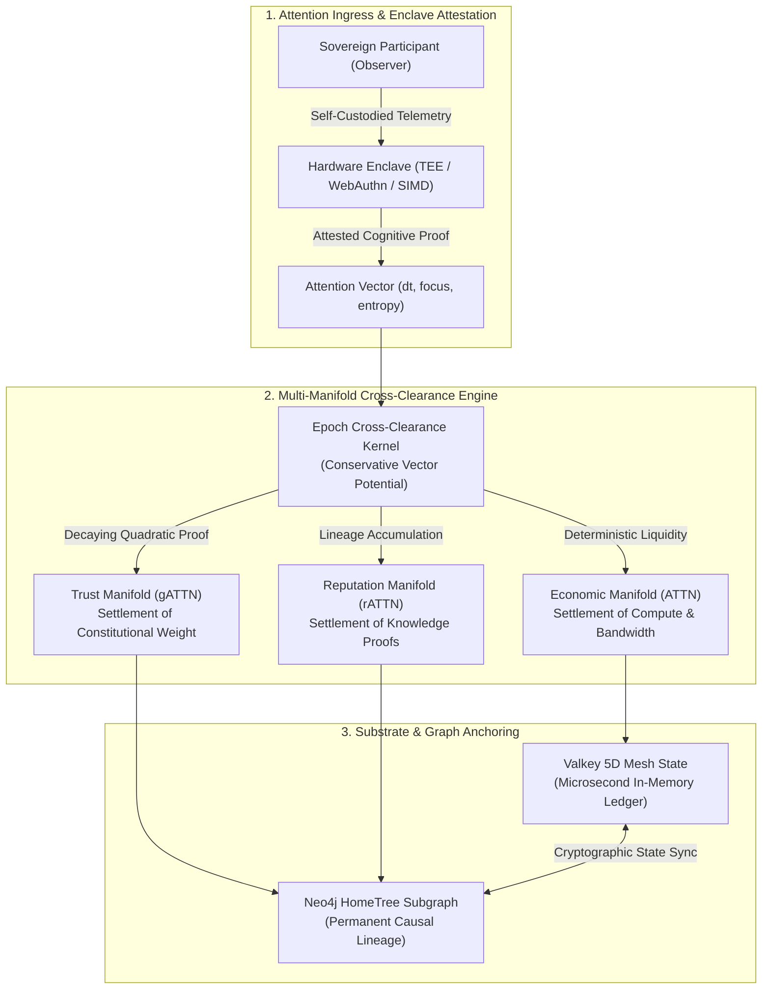

# RFC-0030: Attention Sovereignty Settlement & Multi-Manifold Cross-Clearance Architecture

**RFC Number:** RFC-0030  
**Title:** Attention Sovereignty Settlement & Multi-Manifold Cross-Clearance Architecture  
**Status:** Draft Standard  
**Category:** Economic Settlement / Differential Geometry / Cross-Manifold Topology  
**Amends:** RFC-0026 (ATTN Attention Coordination Network), RFC-0029-A (The Three Capitals Model)  
**Parent RFCs:** RFC-0025 (Attention Civilization Substrate), RFC-0028 (gATTN Governance Scoring), RFC-0029-B (Reputation Capital Subgraph)  
**Constitutional Invariants:** Invariant LIII (Attention Sovereignty & Non-Expropriation), Invariant LIV (Multi-Manifold Conservation & Cross-Clearance), Invariant LV (Topological Settlement Lineage)  

---

## 🏛️ Executive Summary & Principle

Modern digital architectures treat human attention as an uncompensated externality to be extracted, commodified, and auctioned to third parties. In contrast, the Spacebook civilization substrate posits that **human attention is sovereign, finite, and self-custodied biological cognitive bandwidth**.

RFC-0030 establishes the formal mathematical and cryptographic framework for **Attention Sovereignty Settlement**. It defines how attention vectors, localized cognitive workloads, and multi-agent coordination settle across three orthogonal manifolds:

$$\mathcal{M}_{total} = \mathcal{M}_{ATTN} \times \mathcal{M}_{gATTN} \times \mathcal{M}_{rATTN}$$

Where:
1. $\mathcal{M}_{ATTN}$: **Economic Capital Manifold** (Liquid, transferable, consumable coordination energy).
2. $\mathcal{M}_{gATTN}$: **Trust Capital Manifold** (Non-transferable, identity-bound governance weight).
3. $\mathcal{M}_{rATTN}$: **Reputation Capital Manifold** (Contribution-accrued, peer-attested merit topology).

Cross-clearance occurs via deterministic differential geometric mappings with **zero cross-manifold leakage**, ensuring wealth cannot buy governance, and governance cannot arbitrarily seize economic or knowledge capital.

---

## 📜 Constitutional Invariants

### Constitutional Invariant LIII
#### The Attention Sovereignty & Non-Expropriation Invariant

> **"Cognitive attention is the inviolable property of the conscious sovereign observer. No protocol, daemon, or governance chamber may capture, monetize, or reallocate attention tokens without real-time, hardware-enclave-attested cryptographic consent."**

$$\forall p \in \text{Participants}, \quad \text{Consent}(p, \Delta t) = \text{True} \iff \text{Attestation}(SE, p, \Delta t) \land \text{Sign}_{Ed25519}(p, \Delta t)$$

---

### Constitutional Invariant LIV
#### The Multi-Manifold Conservation & Cross-Clearance Invariant

> **"The three capitals (Economic, Trust, Reputation) operate on mutually orthogonal manifolds. Cross-clearance reconciles relative exchange value through work verification without ever violating the non-equivalence condition."**

$$\mathcal{M}_{ATTN} \not\subset \mathcal{M}_{gATTN}, \quad \mathcal{M}_{ATTN} \not\subset \mathcal{M}_{rATTN}, \quad \mathcal{M}_{gATTN} \not\subset \mathcal{M}_{rATTN}$$

$$\oint_{\partial \Omega} \vec{J}_{\text{cross-clearance}} \cdot d\vec{A} = 0 \quad (\text{Zero Unaccounted Capital Leakage})$$

---

### Constitutional Invariant LV
#### The Topological Settlement Lineage Invariant

> **"Every cross-clearance epoch must commit a deterministic Merkle state root anchored permanently to both the Valkey ephemeral substrate and the Neo4j HomeTree Graph-of-Reality."**

$$\mathcal{H}_{epoch} = \text{BLAKE3}\left(\text{Root}_{ATTN} \parallel \text{Root}_{gATTN} \parallel \text{Root}_{rATTN} \parallel \mathcal{H}_{epoch-1}\right)$$

---

## 📐 Multi-Manifold Clearance Topology



---

## 🔬 Mathematical Formulation of Clearance

### 1. Attention Energy Integral
Let an attention stream over time interval $[t_0, t_1]$ be characterized by focus intensity $I_f(t) \in [0, 1]$, cognitive entropy $S_c(t) \ge 0$, and hardware attestation coefficient $\alpha_h \in \{0, 1\}$.

The total attested attention energy $E_{att}$ is defined as:

$$E_{att} = \alpha_h \int_{t_0}^{t_1} I_f(t) \cdot \left(1 - \frac{S_c(t)}{S_{max}}\right) dt$$

### 2. Multi-Manifold Distribution Tensor
The cross-clearance engine decomposes $E_{att}$ into the three orthogonal capital flows:

$$\begin{bmatrix} \Delta ATTN \\ \Delta gATTN \\ \Delta rATTN \end{bmatrix} = \begin{bmatrix} \kappa_{eco} & 0 & 0 \\ 0 & \kappa_{trust} \cdot \Phi_{decay} & 0 \\ 0 & 0 & \kappa_{rep} \cdot \Theta_{peer} \end{bmatrix} \begin{bmatrix} W_{compute} \\ W_{governance} \\ W_{knowledge} \end{bmatrix}$$

Where:
- $W_{compute}$: Verifiable zero-knowledge edge computation completed.
- $W_{governance}$: Deliberative voting and invariant review participation.
- $W_{knowledge}$: Peer-reviewed RFC authorship, code verification, or data curation.
- $\Phi_{decay}$: Exponential participation decay factor $\Phi_{decay} = e^{-\lambda (t - t_{last})}$.
- $\Theta_{peer}$: Attested peer review consensus threshold ($\ge 0.80$).

Notice that the off-diagonal terms are identically zero: **no amount of $W_{compute}$ or $ATTN$ can directly generate $gATTN$ or $rATTN$**.

---

## 🗄️ Neo4j Schema Extensions for Clearance

RFC-0030 introduces dedicated settlement nodes into the HomeTree graph to guarantee Invariant LV:

```cypher
///////////////////////////////////////////////////////////////////////////
// RFC-0030: SETTLEMENT EPOCH & CROSS-CLEARANCE CONSTRAINTS
///////////////////////////////////////////////////////////////////////////

CREATE CONSTRAINT settlement_epoch_id IF NOT EXISTS
FOR (s:SettlementEpoch)
REQUIRE s.id IS UNIQUE;

CREATE INDEX settlement_epoch_timestamp IF NOT EXISTS
FOR (s:SettlementEpoch)
ON (s.timestamp);

CREATE CONSTRAINT clearance_batch_id IF NOT EXISTS
FOR (b:ClearanceBatch)
REQUIRE b.id IS UNIQUE;

CREATE CONSTRAINT attention_claim_id IF NOT EXISTS
FOR (a:AttentionClaim)
REQUIRE a.id IS UNIQUE;
```

### Clearance Traversal Query
```cypher
MATCH (p:Participant {id: $participant_id})-[:GENERATED]->(claim:AttentionClaim)
MATCH (claim)-[:INCLUDED_IN]->(batch:ClearanceBatch)-[:COMMITTED_IN]->(epoch:SettlementEpoch)
RETURN 
    p.id AS participant,
    claim.id AS claim_id,
    claim.attested_energy AS energy,
    batch.total_cleared AS batch_total,
    epoch.state_root AS merkle_root,
    epoch.timestamp AS settlement_timestamp
ORDER BY epoch.timestamp DESC;
```

---

## 🛡️ Attack Vector Defenses

| Attack Vector | Threat Mechanism | RFC-0030 Defense Invariant |
| :--- | :--- | :--- |
| **Synthetic Attention Spoofing** | Bots generating automated viewport activity or clicks | **Invariant LIII:** Hardware Enclave (TEE/WebNN) biometric attestation + entropy threshold $S_c(t) < S_{max}$. |
| **Capital Arbitrage Capture** | Whales buying massive ATTN to influence protocol decisions | **Invariant LIV:** Strict diagonal clearance tensor ($\kappa_{ij} = 0 \text{ for } i \ne j$). ATTN cannot convert to gATTN. |
| **Stale Governance Hoarding** | Inactive legacy participants retaining eternal veto power | **Invariant XLIX & LIV:** Exponential decay multiplier $\Phi_{decay} = e^{-\lambda \Delta t}$. Unused gATTN decays to baseline. |
| **Retroactive History Revision** | Colluding nodes attempting to rewrite historic clearance balances | **Invariant LV:** Chained BLAKE3 cryptographic lineage linking Valkey substrate to immutable Neo4j HomeTree roots. |

---

## 🏛️ Publication Principle & Open Problem Alignment

In accordance with the **Spacebook.University Publication Principle**, RFC-0030 is designated as an open research specification. Empirical clearance parameters ($\kappa_{eco}, \kappa_{trust}, \kappa_{rep}, \lambda$) are dynamic calibration constants subject to continuous real-world verification, peer critique, and algorithmic tuning within **Academic Research Division D3 (Governance Science)** and **Division D4 (Civilization Engineering)**.
