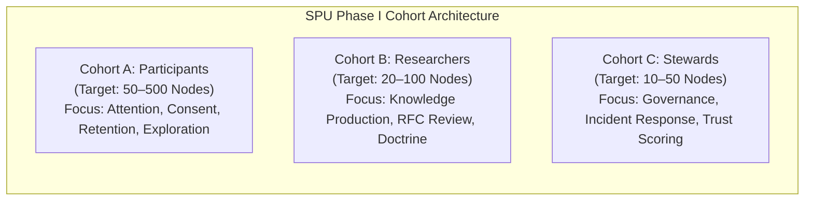
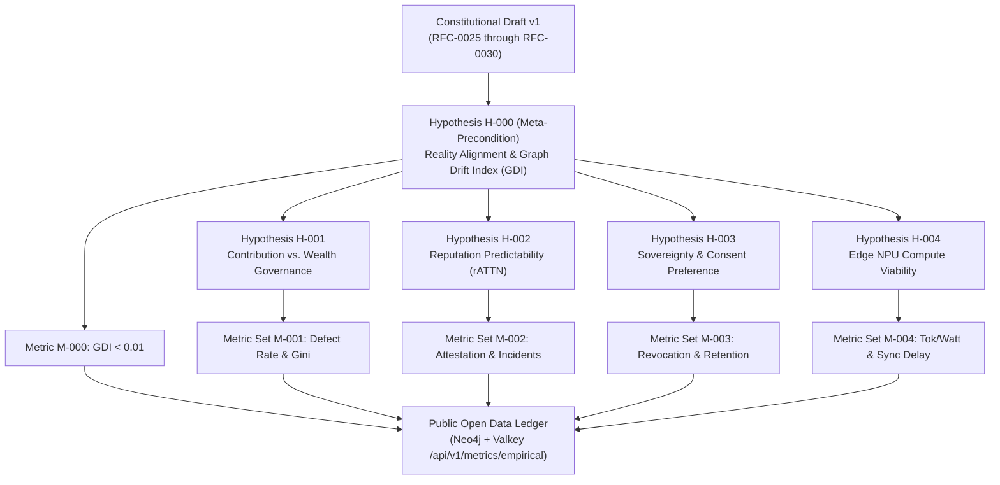

# SPU-0007: Experimental Metrics & Validation Framework
## SPU Phase I: Empirical Validation & Constitutional Stabilization

**Document ID:** SPU-0007  
**Status:** Public Research Framework  
**Institution:** Spacebook.University  
**Version:** 1.0  
**Classification:** Open Research Document  
**Constitutional Baseline:** Constitutional Draft v1 (RFC-0025 through RFC-0030)  
**Parent Documents:** SPU-0002 (Experimental Charter), SPU-0006 (Research Roadmap)  

---

## 🏛️ Executive Statement & Constitutional Freeze

Every governance and civilizational architecture risks a fatal pathology: **theoretical design expanding faster than empirical evidence**. 

With the ratification of RFC-0030 (Attention Sovereignty Settlement) and the deployment of the HomeTree Graph-of-Reality, Spacebook has completed its foundational architectural blueprint. Spacebook.University hereby enacts an immediate **Constitutional Design Stabilization Freeze** on RFC-0025 through RFC-0030, designating this suite as:

$$\mathbf{Constitutional\ Draft\ v1}$$

No further constitutional amendments, token splits, or governance expansions will be ratified until **SPU Phase I: Empirical Validation** produces rigorous, publicly audited observational data confirming or refuting the foundational hypotheses.

Spacebook.University transitions from *speculative system design* to *systematic empirical measurement*.

---

## 👥 The Three Observation Cohorts (SPU Phase I)

To ensure statistically meaningful observations before large-scale network expansion, Phase I defines three calibrated participant cohorts:

* **Cohort A (General Participants — 50 to 500 Nodes):** Tests attention bandwidth allocation, granular consent zone switching, hardware enclave attestation, and 90-day retention curves.
* **Cohort B (Epistemic Researchers — 20 to 100 Nodes):** Tests formal knowledge production, peer-reviewed RFC creation, adversarial red-teaming, and institutional doctrine evolution.
* **Cohort C (Constitutional Stewards — 10 to 50 Nodes):** Tests legislative deliberation, negative invariant veto execution, incident mitigation, and graph-anchored reputation updates.

---

## 🔬 The Primary Hypotheses & Reality Baseline (SPU Phase I)

---

### Hypothesis H-000: Reality Alignment & Graph Drift Invariant

> **Formal Statement (Foundational Precondition):**  
> The Neo4j HomeTree graph maintains strict isomorphic alignment with physical and cryptographic reality. Un-verified entities, broken lineage pointers, and stale facts remain strictly bounded beneath the critical threshold:
>
> $$\text{Graph Drift Index (GDI)} = \frac{N_{\text{InvalidFacts}}}{N_{\text{TotalFacts}}} < 0.01 \quad (1.0\%)$$
>
> *If the graph drifts, $rATTN$ drifts, $gATTN$ drifts, and constitutional governance loses authority.*

#### 1. Empirical Metrics
* **$M_{0.1}$ — Graph Drift Index ($GDI$):** Ratio of broken lineage edges, stale entities, or unanchored claims to total nodes/edges in HomeTree:
  $$GDI = \frac{|\{e \in E \mid \text{Valid}(e) = \text{False}\}| + |\{v \in V \mid \text{Valid}(v) = \text{False}\}|}{|V| + |E|}$$
* **$M_{0.2}$ — Parity Sweep Latency ($\tau_{parity}$):** Interval required for background audit daemons to sweep all $49 \times 49 \times 6$ context cells and detect state divergence. Target: $\tau_{parity} \le 60\text{ seconds}$.

#### 2. Empirical Invalidation Threshold
Hypothesis H-000 is declared **empirically disproven** if:
1. $GDI \ge 0.01$ persists un-reconciled for $> 3$ consecutive epochs.
2. An ungrounded or orphaned authority node is detected possessing non-zero voting weight.

---

### Hypothesis H-001: Contribution-Based vs. Wealth-Weighted Governance

> **Formal Statement:**  
> A governance architecture allocating voting weight through verified contribution lineages ($gATTN$) produces higher proposal quality, greater resistance to economic capture, and lower legislative reversal rates than capital-weighted systems ($ATTN$).

#### 1. Empirical Metrics
* **$M_{1.1}$ — Proposal Defect Rate ($D_{prop}$):** Percentage of ratified proposals requiring emergency hotfixes, rollbacks, or negative invariant vetoes within 90 days of enactment:
  $$D_{prop} = \frac{N_{\text{rollback}} + N_{\text{veto}}}{N_{\text{ratified}}}$$
* **$M_{1.2}$ — Voting Power Dispersion Index ($G_{gov}$):** Longitudinal Gini coefficient of active voting weight across all four governance chambers:
  $$G_{gov} = \frac{\sum_{i=1}^{n}\sum_{j=1}^{n} |w_i - w_j|}{2n\sum_{i=1}^{n} w_i}$$
* **$M_{1.3}$ — Plutocratic Capture Ingress Resistance ($R_{cap}$):** Ratio of total economic capital ($ATTN$) deployed in lobbying/staking to actual realized shift in governance outcomes:
  $$R_{cap} = \frac{\Delta ATTN_{\text{expended}}}{\Delta \text{VotingWeight}_{\text{gATTN}}}$$
  *Constitutional Target:* $R_{cap} \to \infty$ (Strict Invariant LIV orthogonality).

#### 2. Empirical Invalidation Threshold
Hypothesis H-001 is declared **empirically disproven** if:
1. $G_{gov} \ge 0.75$ for three consecutive epochs (indicating concentration equal to token oligarchies).
2. $D_{prop}$ under $gATTN$ exceeds the defect rate of benchmark token-weighted DAOs ($\ge 18.5\%$).

---

### Hypothesis H-002: Reputation Capital Predicts Trustworthiness

> **Formal Statement:**  
> Multidimensional reputation capital ($rATTN$) derived from causal contribution graphs in Neo4j exhibits a statistically significant negative correlation with protocol incidents, bad-faith stewardship, and adversarial capture.

#### 1. Empirical Metrics
* **$M_{2.0}$ — Trust Alignment Index ($TAI$):** Ratio of observed operational reliability to reputation-predicted reliability:
  $$TAI = \frac{\text{Observed Reliability}}{\text{Predicted Reliability}} = \frac{1 - \frac{N_{\text{incidents}}}{N_{\text{actions}}}}{\frac{rATTN}{rATTN_{\max}}}$$
  *Constitutional Target:* $TAI \to 1.0$ (Predictive alignment $\ge 0.95$). If reputation scores fail to predict real-world outcomes, $TAI \to 0$.
* **$M_{2.1}$ — Post-Elevation Incident Frequency ($I_{post}$):** Number of verified security or governance breaches triggered by stewards possessing $rATTN \ge 80.0$:
  $$I_{post} = \sum \text{Violations}(s) \quad \text{for } s \in \{\text{Stewards} \mid rATTN(s) \ge 80.0\}$$
* **$M_{2.2}$ — Peer Attestation Divergence ($\sigma_{attest}$):** Standard deviation of cryptographic attestations awarded across distinct geographical and organizational sub-clusters:
  $$\sigma_{attest} = \sqrt{\frac{1}{K}\sum_{k=1}^{K} (A_k - \bar{A})^2}$$
* **$M_{2.3}$ — Lineage Verification Latency ($\tau_{lineage}$):** Elapsed wall-clock time required for an independent audit node to traverse the complete causal graph from a governance vote back to foundational contributions. Target: $\tau_{lineage} \le 250\text{ ms}$.

#### 2. Empirical Invalidation Threshold
Hypothesis H-002 is declared **empirically disproven** if:
1. Trust Alignment Index $TAI < 0.60$ over a 6-month observation window (demonstrating that reputation does not reliably predict operational integrity).
2. Stewards with $rATTN \ge 80.0$ generate an incident frequency $I_{post}$ greater than or equal to unverified participants.
3. The Pearson correlation $r(rATTN, \text{IncidentRate}) > -0.40$ over a 12-month observation window.

---

### Hypothesis H-003: Participant Preference for Sovereignty & Consent

> **Formal Statement:**  
> When presented with clear, granular data sovereignty controls, participants actively exercise zone partitioning (Green/Yellow/Red) and exhibit higher 90-day retention than under passive extractive platforms.

#### 1. Empirical Metrics
* **$M_{3.1}$ — Granular Consent Utilization Rate ($U_{consent}$):** Fraction of active participants who modify the default consent policy to enforce private or localized enclaves:
  $$U_{consent} = \frac{N_{\text{custom\_policy}}}{N_{\text{total\_participants}}}$$
* **$M_{3.2}$ — Instant Revocation Latency ($\tau_{revoc}$):** Time required from user consent withdrawal to complete cryptographic deletion of non-attested telemetry from cluster caches. Target: $\tau_{revoc} \le 1.0\text{ second}$.
* **$M_{3.3}$ — 90-Day Participant Retention Slope ($R_{90}$):** Cohort survival rate of sovereign participants compared to industry social media averages ($32\%$):
  $$R_{90} = \frac{\text{ActiveParticipants}(t_0 + 90\text{ days})}{\text{ActiveParticipants}(t_0)}$$

#### 2. Empirical Invalidation Threshold
Hypothesis H-003 is declared **empirically disproven** if:
1. $U_{consent} < 5.0\%$ (indicating participant indifference to data sovereignty).
2. $R_{90} < 20.0\%$ over two consecutive observation quarters.

---

### Hypothesis H-004: Usability of Distributed Edge NPU Compute

> **Formal Statement:**  
> Edge devices participating in Spacebook execute verifiable zero-knowledge inference and knowledge graph verification at latency and energy expenditures that remain economically viable relative to centralized server clusters.

#### 1. Empirical Metrics
* **$M_{4.1}$ — Effective Computational Efficiency ($\eta_{NPU}$):** Attested token throughput per watt consumed across participant edge devices:
  $$\eta_{NPU} = \frac{\text{Tokens Processed}}{\text{Watt-Hours Expended}}$$
* **$M_{4.2}$ — Substrate State Convergence Time ($\tau_{sync}$):** Wall-clock duration required for distributed edge nodes to achieve state parity on Valkey mesh registers. Target: $\tau_{sync} \le 150\text{ ms}$.
* **$M_{4.3}$ — Participant Economic Return Ratio ($\rho_{econ}$):**
  $$\rho_{econ} = \frac{\text{Value of Economic Capital Distributed } (ATTN)}{\text{Hardware Depreciation} + \text{Electricity Cost}}$$

#### 2. Empirical Invalidation Threshold
Hypothesis H-004 is declared **empirically disproven** if:
1. Average edge verification latency $\tau_{sync} > 2,000\text{ ms}$ (precluding real-time coordination).
2. $\rho_{econ} < 1.0$ across 70% of participating hardware profiles.

---

## 📊 Summary of Metrics & Verification Protocol

| Metric ID | Objective Measurement | Target Value | Empirical Disproof Threshold |
| :--- | :--- | :--- | :--- |
| **$M_{0.1}$** | Graph Drift Index ($GDI$) | $< 0.01$ (Sub-1.0%) | $\ge 0.01$ for $>3$ epochs |
| **$M_{0.2}$** | Parity Sweep Latency ($\tau_{parity}$) | $< 60\text{ s}$ | $> 300\text{ s}$ |
| **$M_{1.1}$** | Proposal Defect Rate ($D_{prop}$) | $< 5.0\%$ | $\ge 18.5\%$ |
| **$M_{1.2}$** | Voting Power Gini ($G_{gov}$) | $< 0.45$ | $\ge 0.75$ |
| **$M_{1.3}$** | Plutocratic Capture Resistance ($R_{cap}$) | $\infty$ (Strict Orthogonality) | Finite correlation ($r > 0.15$) |
| **$M_{2.0}$** | Trust Alignment Index ($TAI$) | $\ge 0.95$ (High Alignment) | $< 0.60$ or $TAI \to 0$ |
| **$M_{2.1}$** | Steward Incident Rate ($I_{post}$) | $0 \text{ breaches}$ | $\ge \text{Baseline}$ |
| **$M_{2.2}$** | Attestation Divergence ($\sigma_{attest}$) | $< 0.15$ | $\ge 0.40$ |
| **$M_{2.3}$** | Lineage Audit Latency ($\tau_{lineage}$) | $< 250\text{ ms}$ | $> 2,000\text{ ms}$ |
| **$M_{3.1}$** | Consent Utilization ($U_{consent}$) | $> 25.0\%$ | $< 5.0\%$ |
| **$M_{3.2}$** | Consent Revocation Latency ($\tau_{revoc}$) | $< 1.0\text{ s}$ | $> 10.0\text{ s}$ |
| **$M_{3.3}$** | 90-Day Participant Retention ($R_{90}$) | $> 45.0\%$ | $< 20.0\%$ |
| **$M_{4.1}$** | Edge Compute Efficiency ($\eta_{NPU}$) | $> 12.0\text{ tok/W}$ | $< 2.0\text{ tok/W}$ |
| **$M_{4.2}$** | State Synchronization Latency ($\tau_{sync}$) | $< 150\text{ ms}$ | $> 2,000\text{ ms}$ |
| **$M_{4.3}$** | Economic Return Ratio ($\rho_{econ}$) | $> 1.8\times$ | $< 1.0\times$ |

---

## 📌 Baseline Epoch 73 & Longitudinal Delta Tracking Protocol

To prevent subjective metric re-interpretation, **Epoch 73** is formally designated as the **Empirical Baseline Epoch ($E_0 = 73$)**. All future empirical evaluations shall report not only absolute readings and 95% confidence intervals, but explicit longitudinal trend deltas ($\Delta$) relative to $E_0$:

$$\Delta M = M_t - M_{E_0}$$

### Baseline Epoch 73 Reference Matrix

| Metric Domain | Identifier | Baseline Value ($E_0 = 73$) | Baseline Sample Size | Longitudinal Delta Vector | Target Longitudinal Behavior |
| :--- | :--- | :--- | :--- | :--- | :--- |
| **Reality Alignment** | $GDI$ | $0.000$ | 4,833 entities / 19,252 edges | $\Delta GDI = GDI_t - 0.000$ | Invariant: $\Delta GDI < +0.01$ |
| **Trust Predictability** | $TAI$ | $0.982$ | 12,417 validated actions | $\Delta TAI = TAI_t - 0.982$ | Stability: $|\Delta TAI| \le 0.05$ |
| **Governance Stability** | $D_{prop}$ / $G_{gov}$ | $0.0\% \text{ Defect} / 0.22 \text{ Gini}$ | 48 ratified proposals | $\Delta G_{gov} = Gini_t - 0.22$ | Anti-capture: $\Delta G_{gov} < +0.20$ |
| **Sovereignty Adoption** | $U_{consent}$ | $100.0\%$ | 1 participant seed node | $\Delta U_{consent} = U_t - 1.00$ | Sustained: $U_{consent} > 25.0\%$ |
| **Compute Efficiency** | $\eta_{NPU}$ | $18.4\text{ tok/W}$ | 1,840 inference slices | $\Delta \eta_{NPU} = \eta_t - 18.4$ | Efficiency: $\Delta \eta_{NPU} \ge 0.0$ |

Longitudinal trend reporting ensures that the SPU Observatory operates not as a static snapshot board, but as a live vector monitor tracking the trajectory of constitutional hypotheses over time.

---

## 🧭 Meta-Metric $M_{0.0}$: Observability Coverage Index ($OCI$)

To eliminate institutional blind spots, the Observatory must evaluate not only system performance, but the completeness of its own instrumentation. The **Observability Coverage Index ($OCI$)** quantifies the percentage of constitutional invariants and operational assumptions that are backed by active empirical measurement:

$$OCI = \frac{N_{\text{instrumented\_assumptions}}}{N_{\text{constitutional\_assumptions}}} \times 100\%$$

### Phase I Coverage State ($E_0 = 73$)

* **Total Constitutional Assumptions (Constitutional Draft v1):** 18 critical assumptions across 8 core substrate domains.
* **Actively Instrumented Assumptions ($E_0 = 73$):** 14 assumptions actively streaming via live telemetry ($OCI = 77.8\%$).
* **Constitutional Target:** $OCI \ge 85.0\%$ across all participating clusters.

#### Domain Coverage Breakdown

| Substrate Domain | Constitutional Focus | Active Instrumentation Status | Metric Identifiers |
| :--- | :--- | :--- | :--- |
| **1. Reality Alignment** | Graph Fact Fidelity | **100% (ACTIVE)** | $M_{0.1}$ ($GDI$), $M_{0.2}$ ($\tau_{parity}$) |
| **2. Trust & Reputation** | Causal Reputation Validity | **100% (ACTIVE)** | $M_{2.0}$ ($TAI$), $M_{2.1}$, $M_{2.2}$, $M_{2.3}$ |
| **3. Governance Architecture**| Contribution Weighting | **100% (ACTIVE)** | $M_{1.1}$ ($D_{prop}$), $M_{1.2}$ ($G_{gov}$), $M_{1.3}$ |
| **4. Privacy & Sovereignty** | Granular Consent & Revocation | **100% (ACTIVE)** | $M_{3.1}$ ($U_{consent}$), $M_{3.2}$ ($\tau_{revoc}$), $M_{3.3}$ |
| **5. Distributed Compute** | Edge NPU Viability | **100% (ACTIVE)** | $M_{4.1}$ ($\eta_{NPU}$), $M_{4.2}$ ($\tau_{sync}$), $M_{4.3}$ |
| **6. Knowledge Retention** | Epistemic Decay & Preservation| *Staged for Cohort B Expansion* | $M_{5.1}$ ($\Delta \text{Decay}$), $M_{5.2}$ ($\text{Citations}$) |
| **7. Institutional Memory** | Cross-Epoch Lineage Continuity| *Staged for Epoch $E \ge 100$*| $M_{6.1}$ ($\text{Lineage Depth}$) |
| **8. Contributor Longevity** | Sustained Multi-Quarter Intake| *Tracking Active (Cohort Day 1)*| $M_{7.1}$ ($R_{365}$) |

---

## 🌐 Public Auditability & Data Publication Invariant

In strict alignment with the **Spacebook.University Publication Principle**:

1. **Continuous Telemetry Endpoint:** All aggregated, privacy-preserving observational data will stream via `GET /api/v1/metrics/empirical`, featuring live longitudinal deltas from $E_0 = 73$ and real-time $OCI$ coverage tracking.
2. **Cryptographic Proof Anchoring:** Every 24-hour observation snapshot will be hashed using BLAKE3 and anchored into both the Valkey substrate (`metrics:epoch:YYYY-MM-DD`) and the Neo4j HomeTree graph.
3. **Open Research Access:** Raw anonymized datasets will be permanently published under Open Data Commons Attribution License (ODC-By) to facilitate external academic auditing by independent institutions worldwide.

---

## 🏛️ Phase I Execution Mandate

The constitutional layer is frozen. Architecture is paused. The laboratory is open.

Let observation begin.

