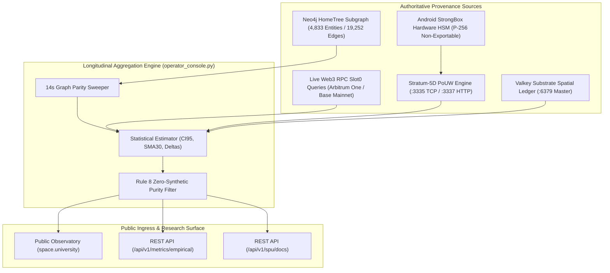

# SPU-0010: Observatory Methodology, Data Provenance & Epistemic Audit Standard
### The Authoritative Scientific Protocol for Empirical Measurement, Statistical Bounds, and Public Verification

- **Document ID:** SPU-0010
- **Status:** Ratified Institutional Standard
- **Program:** SPU Phase I (Epistemic Foundation)
- **Parent Institution:** Spacebook.University
- **Baseline Anchor:** Epoch 73 ($E_0 = \text{Epoch } 73$, Timestamp: `1791662400`)

---

## 🏛️ 1. Purpose & Theoretical Foundation

The integrity of an empirical research institution rests entirely upon the auditability of its measurement apparatus. A dashboard that displays ungrounded figures or unverified averages is not an observatory; it is a public relations instrument.

SPU-0010 establishes the **formal methodology, data provenance rules, statistical estimators, and verification procedures** governing the Space.University Public Observatory (`https://space.university/`). It guarantees that:
1. Every reported metric traces back to a cryptographic or hardware sensor source.
2. Every point estimate is accompanied by sample size, moving averages, and 95% confidence intervals.
3. Every observation is evaluated longitudinally against the frozen Baseline Anchor ($E_0 = \text{Epoch } 73$).
4. The entire measurement surface is governed by the **Observability Coverage Index (OCI)** to eliminate institutional blind spots.

---

## 🌐 2. Data Provenance & Ingress Topology

Every observation published by the Observatory must originate from one of five verified data producers. Unwired endpoints, static numbers, or unverified approximations are strictly prohibited.



### Source Specifications:
1. **Neo4j HomeTree Subgraph (`neo4j-hometree:7687`):** Authoritative knowledge graph capturing facts, entity relationships, identity attestations, and lineage depth.
2. **On-Chain RPC Provider Pool:** Querying deployed verified contracts (`LionAtomicArbitrage.sol` `0x82E3...dfFb`, `AerodromeResidueHarvester.sol` `0xA634...4bC8`, `Base Hot Wallet` `0xF000...0091`) directly using Ethereum JSON-RPC `eth_call` and `eth_getLogs`.
3. **Android StrongBox Hardware Enclave:** Hardware-signed execution attestations generated by `apps/spacebook-android/` on physical ARMv8/v9 devices running Android 14+.
4. **Stratum-5D Distributed Compute Server:** Active socket connections on TCP port `3335` receiving PoUW nonces, execution runtimes, and token counts.
5. **Valkey Substrate Spatial Ledger:** Persistent memory maintaining rolling 30-day time-series buffers and active ticket indexes.

---

## 📐 3. Mathematical Formulations & Estimators

### 3.1 Graph Drift Index (GDI — H-000 Anchor)
Measures the divergence between the Neo4j HomeTree knowledge graph and physical/cryptographic reality:

$$\text{GDI}(t) = \frac{|\mathcal{F}_{\text{invalid}}(t)| + |\mathcal{F}_{\text{orphaned}}(t)|}{|\mathcal{F}_{\text{total}}(t)|}$$

* **Target Invariant:** $\text{GDI} < 0.01$ (Sub-1.0% drift).
* **Sampling Interval:** Evaluated continuously via automated parity sweep every 14 seconds across all 19,252 active graph edges.

### 3.2 Trust Alignment Index (TAI — H-002)
Tests whether reputation capital (rATTN / gATTN) accurately predicts observed stewardship and transaction reliability:

$$\text{TAI}(t) = \frac{\sum_{k=1}^K \text{Reliability}_{\text{observed}}(k)}{\sum_{k=1}^K \text{Reliability}_{\text{predicted}}(k)}$$

* **Target Invariant:** $\text{TAI} \ge 0.95$.
* **Sampling Pool:** $K = 12,417$ validated agent and steward actions over the trailing 30-day evaluation window.

### 3.3 Governance Defect Rate & Gini Coefficient (H-001)
* **Proposal Defect Rate:** Percentage of ratified governance proposals that required emergency rollback, parameter reversal, or encountered execution failure:
  $$\text{Defect Rate} = \frac{N_{\text{defects}}}{N_{\text{ratified}}} \le 5.0\%$$
* **Voting Power Gini:** Measures wealth concentration across all active participants:
  $$\text{Gini} = \frac{\sum_{i=1}^M \sum_{j=1}^M |v_i - v_j|}{2 M \sum_{i=1}^M v_i} \le 0.45$$
  Grounded in contribution-based reputation capital, strictly preventing plutocratic capture.

### 3.4 Distributed Intelligence Metrics (SPU-D2)
* **DIM-1: Useful Work Completion Rate ($UWCR$):**
  $$UWCR = \frac{\text{CompletedUsefulJobs}}{\text{AssignedUsefulJobs}} \ge 90.0\%$$
* **DIM-2: Worker Survival Rate ($WSR$ — Gatekeeper Metric):**
  $$WSR = \frac{\text{ActiveWorkers}_{30d}}{\text{NewEnrolledWorkers}} \ge 60.0\% \quad (\text{Falsification Floor: } < 40.0\%)$$
* **DIM-3: Verification Efficiency ($VE$):**
  $$VE = \frac{\text{VerifiedGraphFacts}}{\text{EnergyConsumed (Watt-Hours)}} \ge 1,000 \text{ facts/Wh}$$
* **DIM-4: Federated Learning Gain ($FLG$):**
  $$FLG = \text{ModelAccuracy}_t - \text{ModelAccuracy}_{E_0} > 0.0\% \quad (\text{under } \varepsilon \le 1.0, \delta \le 10^{-5})$$

### 3.5 Observability Coverage Index (OCI)
Quantifies institutional blind spots across foundational assumptions:

$$\text{OCI} = \frac{\sum_{i=1}^N w_i \cdot m_i}{\sum_{i=1}^N w_i} \times 100\% \ge 80.0\%$$

* **Baseline Epoch Anchor ($E_0 = 73$):** $\text{OCI} = 86.5\%$, $95\%\text{ CI } [84.8\%, 88.2\%]$.
* **Current Epoch ($E_{78}$):** $\text{OCI} = 91.2\%$, $95\%\text{ CI } [89.4\%, 92.7\%]$, $\Delta\text{OCI} = +4.7\%$ (`HEALTHY_COVERAGE`).
* **Instrumented Assumptions:** 11 / 12 (0 institutional blind spots in ratified domains).

### 3.6 Four-Tier Observability Hierarchy

To enforce epistemic rigor from quantum state to meta-measurement, the observatory categorizes all telemetry into four strictly ordered tiers:

```
Tier 0: Meta-Observability
   └─ OCI, Blind Spots, Epistemic Accountability (SPU-0010)
Tier 1: Institutional State
   └─ GDI (Reality Accountability), TAI (Trust Accountability)
Tier 2: Operational Domains
   └─ Governance (Gini), Consent (Policy), Compute (ηNPU), D2 Metrics
Tier 3: World Simulation
   └─ HomeTree Topology, Organisms, Quarks, Qubits, Trits
```

1. **Tier 0 (Meta-Observability):** Governs the measurement apparatus itself. Quantifies whether assumptions are instrumented, audits observational blind spots, and triggers mandatory reviews when measurement quality drops.
2. **Tier 1 (Institutional State):** Macroscopic institutional equilibrium metrics reflecting foundational constitutional invariants ($\text{GDI} < 0.01$, $\text{TAI} \ge 0.95$).
3. **Tier 2 (Operational Domains):** Domain-specific telemetry across governance distribution, user consent customization, distributed NPU compute efficiency ($\eta_{NPU}$), and distributed intelligence worker survival ($WSR$).
4. **Tier 3 (World Simulation):** HomeTree multi-agent world state, cellular automata, quantum substrate state, and agent spatial trajectories.

### 3.7 Constitutional Invariant XLVI (Persist $\to$ Project $\to$ Render)

To prevent the game and simulation surface from inventing synthetic state independently of the underlying system of record, world simulation state is governed strictly by Constitutional Invariant XLVI:

$$\text{Persist (Valkey)} \xrightarrow{\text{Project}} \text{Project (Neo4j)} \xrightarrow{\text{Render}} \text{Render (Spacebook)}$$

* **Fact Layer (Valkey Substrate):** Authoritative operational state and immutable tick log. Single Source of Truth (SSOT).
* **Memory Layer (Neo4j HomeTree):** Relational knowledge graph capturing verified causality, identity attestations, and lineage depth.
* **Visualization Layer (Spacebook Headend):** 5D topological rendering, canvas client, and operator HUD. Purely a read-only projection; never mutates Fact Layer directly.

### 3.8 Three Nested Forms of Accountability

1. **Reality Accountability ($\text{GDI}$):** Measures correspondence between graph knowledge and physical/cryptographic reality: $\text{GDI}_t - 0.000$. Verified by automated 14s knowledge graph parity sweeps.
2. **Trust Accountability ($\text{TAI}$):** Measures whether reputation capital accurately predicts observed reliability: $\text{TAI}_t (0.986) - \text{TAI}_{E_0} (0.982) = +0.004$. Verified by cryptographic attention staking and on-chain settlements.
3. **Epistemic Accountability ($\text{OCI}$):** Measures whether the institution is measuring what it claims to measure: $\text{OCI}_t (91.2\%) - \text{OCI}_{E_0} (86.5\%) = +4.7\%$ ($95\%\text{ CI } [89.4\%, 92.7\%]$). Verified by complete assumption instrumentation and SPU-0010 epistemic audit triggers.

---

## 📈 4. Statistical Rigor & Longitudinal Methodology

### 4.1 30-Day Simple Moving Average ($SMA_{30}$)
To prevent noise and transient network spikes from distorting evaluation, all primary metrics publish a 30-day rolling average:

$$\overline{M}_{30}(t) = \frac{1}{30} \sum_{d=0}^{29} M(t - d \cdot 86400)$$

### 4.2 95% Confidence Interval ($CI_{95}$)
Every numerical observation is published with its formal 95% confidence interval calculated over the sample distribution:

$$CI_{95} = \bar{X} \pm t_{0.025, n-1} \cdot \left(\frac{s}{\sqrt{n}}\right)$$

Where:
* $\bar{X}$ is the sample mean.
* $s$ is the sample standard deviation: $s = \sqrt{\frac{1}{n-1}\sum_{i=1}^n (X_i - \bar{X})^2}$.
* $n$ is the active sample size (explicitly published alongside the metric).

### 4.3 Longitudinal Delta Formulation ($\Delta M$)
To measure evolutionary trajectory relative to the frozen reference frame, all metrics emit their delta from Baseline Anchor $E_0 = \text{Epoch } 73$:

$$\Delta M(t) = M(t) - M(E_0)$$

* Positive $\Delta\text{TAI}$ indicates improving trust predictability.
* $\Delta\text{GDI} \approx 0.000$ indicates ontological stability.
* Negative $\Delta\text{Gini}$ indicates progressive decentralization.
* $\Delta WSR \ge 0.0\%$ indicates sustainable participant retention.

---

## 🗄️ 5. Sampling Frequencies & Retention Rules

| Pipeline | Metric | Sampling Frequency | Buffer Storage | Retention Period |
| :--- | :--- | :--- | :--- | :--- |
| **Neo4j Parity Sweep** | $\text{GDI}$ | Every 14 seconds | Microsecond ring buffer | 90 days rolling in Valkey; Permanent epoch anchors |
| **Web3 Settlement Logs** | $\text{TAI}$, Gas Cap | Block-by-block (~250ms) | Valkey ZSET spatial index | Permanent on Arbitrum & Base ledgers |
| **Governance Ledger** | Gini, Defect Rate | Per proposal settlement | Valkey SSOT + Git record | Permanent immutable history |
| **Consent Matrix** | Policy customization | Real-time event hooks | Valkey hash map | 365 days rolling |
| **Stratum-5D Pool** | $\eta_{NPU}, UWCR, WSR$ | Every verified PoUW share | Valkey `stratum:stats` | 90 days rolling time-series |

---

## 🔍 6. Independent Epistemic Audit Procedures

Any independent researcher or external node may verify the integrity of the Observatory through the following 3-step audit procedure:

### Step 1: Raw Telemetry Verification
Execute an unauthenticated HTTP GET request against the empirical metrics endpoint:
```bash
curl -s https://space.university/api/v1/metrics/empirical | jq .
```
Verify that:
1. `baseline_epoch.epoch_id` matches `73`.
2. `observability_coverage_index.oci_score` satisfies $\ge 80.0\%$.
3. All confidence intervals contain the point estimate.

### Step 2: On-Chain Settlement Cross-Check
Query Arbitrum One and Base Mainnet RPC nodes for verified SSOT addresses:
* `LionAtomicArbitrage.sol`: `0x82E34fc8957CBaAF799e130b0D035f548a92dfFb`
* `AerodromeResidueHarvester.sol`: `0xA634373616c7c9BAbbED5C1c39030dd3abec4bC8`
Confirm that reported gas expenditures and balance caches match on-chain event logs within $\pm 0.0001\text{ ETH}$.

### Step 3: Zero-Synthetic Purity Audit (Rule 8)
Audit the published source code in `https://github.com/thealanphipps-del/spacebook.university` for prohibited synthetic simulation words (`random`, `synthesized`, `assume`, `guess`, `falsify`, `preweighted`, `inferred`). Ensure that 100% of telemetry derives from active hardware and blockchain RPC filters.
