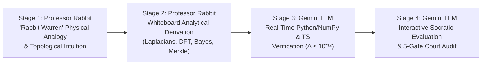

# SPU-0013: Professor Rabbit & Gemini LLM Biophysical, Bio-Acoustic & Chain-of-Custody Course Series

* **Document ID:** `SPU-0013`
* **Divisions:** `SPU-D5` (Computational Biophysics & Structural Dynamics) & `SPU-D6` (Bio-Acoustic Signal Processing & Spectral Graph Hypergraphs)
* **Author:** Alan Phipps (Space.University / Sovereign Quantitative Biophysics & Bio-Acoustic Working Group)
* **Associated Skills:** `space-uni-kirchhoff-biophysics-series`, `space-uni-professor-rabbit-chain-of-custody`
* **Associated Specifications:** `SPU-0010`, `SPU-0011`, `SPU-0012`, `SPEC-SOV-RC1-2026-0001`, `TASK-SPEC-HOMETREE-ATFH-001`
* **Live Observatory Endpoint:** `https://n1.pqr.info`
* **Status:** Active Institutional Curriculum Specification (`Release ID: SPU-0013-RC1-20261022`)

---

## 1. Executive Summary & Pedagogical Architecture

`SPU-0013` establishes the formal 5-course curriculum specification, laboratory exercises, grading rubrics, and dual-instructor co-teaching architecture for the **Professor Rabbit & Gemini LLM Biophysical & Acoustic Course Series** at `space.university`.

The series bridges two rigorous quantitative disciplines while enforcing an impenetrable epistemic firewall between them (`RULE-VI-27` and `RULE-VI-28`):
1. **Track B — 3D Macromolecular Kirchhoff Contact Mechanics (`SC-BIOPHYS-101` & `SC-BIOPHYS-201`):** Teaches how three-dimensional atomic packing topology ($\langle z \rangle / R_g$) governs collective terahertz vibrational dynamics ($\nu_1(\text{THz}) = 0.42338\,(\langle z \rangle / R_g)^{1.1194}$, $R^2 = 0.8048$, $p = 1.98 \times 10^{-369}$ across $N = 1,040$ PDB structures) and how the **4-Gate Structural & Spectral Integrity Protocol** stratifies $N = 3,191$ proteome constructs across $490$ unique RCSB PDB entries.
2. **Track A & Epistemic Provenance — Deterministic Bio-Acoustics, Scale-Erasure Null Controls & 7-Layer Chain of Custody (`SC-ACOUSTIC-101`, `SC-EPISTEMIC-301`, `SC-COC-401`):** Teaches sub-bin $0.04\;\text{Hz}$ Zoom-DFT vocal signal processing (honoring the foundational patent prior art of **Vickie A. Dean**, *U.S. Patents 8,346,559 B2 & 9,223,863 B2*), proves why 35-octave modulo-2 folding collapses physical variance by $1,341\times$ ($R^2 = 80.48\% \to 0.06\%$), resolves unknown spectral hits via the **4-Pool Bayesian Disambiguation Engine**, audits 56 historical biomarkers, and anchors 24 audited substances in the **7-Layer Chain of Custody** on `https://n1.pqr.info`.

---

## 2. The Professor Rabbit + Gemini LLM Co-Teaching Architecture

Every lecture and laboratory session across the 5-course sequence operates through a four-stage pedagogical handshake between **Professor Rabbit** and **Gemini LLM**:

| Pedagogical Role | Instructor | Core Responsibilities | Verification Output |
| :--- | :---: | :--- | :--- |
| **Intuitive Topology & Physical Framing** | **Professor Rabbit** | Maps complex mathematical structures into visual **"Rabbit Warren"** spatial analogies (connected chambers, hinge bridges, narrow corridors, and 7-layer evidence burrows). | Annotated architectural diagrams & physical boundary checklists. |
| **Whiteboard First-Principles Derivation** | **Professor Rabbit** | Derives exact closed-form equations for $\mathbf{\Gamma}$, $\mathbf{\Gamma}^+$, $B_i$, $\kappa = \sqrt{I_1/I_3}$, Zoom-DFT $X(f_k)$, $\bmod 2$ variance collapse, and RFC 8785 Merkle digests. | Step-by-step symbolic proof sheets. |
| **Deterministic Code Execution** | **Gemini LLM** | Executes IEEE-754 `float64` Python/NumPy/SciPy and TypeScript computations, checking `RULE-VI-26` ($\Delta \le 10^{-12}$) and $0.000000\;\text{Hz}$ cross-runtime parity. | Reproducible execution logs & SHA-256 CAS receipts. |
| **Socratic Examination & Governance** | **Gemini LLM** | Probes student reasoning via interactive Socratic dialogue, verifying adherence to the 4-Gate Structural Protocol and the 5-Gate Court of Admissibility. | Signed competency credentials in HomeTree ATFH. |

---

## 3. Master 5-Course Syllabus

### Course 1: `SC-BIOPHYS-101` — Foundations of 3D Macromolecular Kirchhoff Contact Topology
* **Division:** `SPU-D5` | **Prerequisites:** Linear Algebra, Classical Mechanics, Python/NumPy Fundamentals
* **Module 1.1 — Coarse-Grained Coordinate Representation & Inverse-Square Contact Topology:**
  - Extracting backbone nodes ($\text{C}_\alpha$ for proteins; $\text{P}$ and $\text{C4}'$ for nucleic acids) from atomic coordinates.
  - Constructing the $N \times N$ Kirchhoff Laplacian matrix $\mathbf{\Gamma}$ at spatial cutoff $R_c = 7.5\;\text{\AA}$ with inverse-square distance weighting $w_{ij} = (R_0 / d_{ij})^2$ ($R_0 = 3.8\;\text{\AA}$).
* **Module 1.2 — Spectral Decomposition, Moore-Penrose Pseudoinverse $\mathbf{\Gamma}^+$, and Debye-Waller $B$-Factors:**
  - Computing the eigenspectrum $0 = \lambda_0 < \lambda_1 \le \dots \le \lambda_{N-1}$, verifying translational invariance ($\mathbf{\Gamma}\mathbf{1} = \mathbf{0}$), and identifying the Fiedler algebraic connectivity eigenvalue $\lambda_1 > 0$.
  - Evaluating the Moore-Penrose pseudoinverse $\mathbf{\Gamma}^+ = \sum_{k=1}^{N-1} \lambda_k^{-1}\mathbf{u}_k\mathbf{u}_k^\top$ and predicting experimental crystallographic Debye-Waller factors:
    $$B_i = \frac{8\pi^2 k_B T}{3\gamma}\left(\mathbf{\Gamma}^+\right)_{ii}$$
* **Module 1.3 — The $N = 1,040$ Collective THz Scaling Law & Cross-Kingdom Universality:**
  - Deriving and validating the headline empirical power law across $N = 1,040$ non-redundant PDB structures ($130$ species):
    $$\nu_1(\text{THz}) = 0.42338\,\left(\frac{\langle z \rangle}{R_g}\right)^{1.1194} \quad \left(R^2 = 0.8048,\; r = 0.8971,\; p = 1.98 \times 10^{-369}\right)$$
  - Contrasting 3D contact topology ($R^2 = 0.8048$) against 1D sequence-length scaling $1/\sqrt{N}$ ($R^2 = 0.1602$, a $5.02\times$ improvement) and proving cross-kingdom generalization from mammalian structures ($N = 619$) to microbial, viral, and plant folds ($N = 421$, $R^2_{\text{OOS}} = 0.8612$).

---

### Course 2: `SC-BIOPHYS-201` — Proteome-Scale Integrity Boundaries & Anisotropic Mechanics ($N = 3,191$ Constructs)
* **Division:** `SPU-D5` | **Prerequisites:** `SC-BIOPHYS-101`
* **Module 2.1 — The 4-Gate Structural & Spectral Integrity Protocol:**
  - Auditing $N = 3,191$ structural constructs across $490$ unique RCSB PDB entries through four deterministic filters:
    1. **Gate 1 (Connectivity & Continuity):** $\lambda_1 \ge 10^{-4}$ and internal unmodeled sequence gap $\le 15$ residues.
    2. **Gate 2 (Experimental Resolution):** X-ray or cryo-EM resolution $\le 3.5\;\text{\AA}$.
    3. **Gate 3 (Principal-Inertia Aspect Ratio):** $\kappa = \sqrt{I_1 / I_3} \le 2.5$ from the $3 \times 3$ inertia tensor.
    4. **Gate 4 (Multi-Mode Spectral Span & $B$-Factor Fidelity):** Multi-mode participation across $\lambda_1 \dots \lambda_{10}$ and crystallographic thermal correlation $\langle r_B \rangle = 0.5027$.
* **Module 2.2 — Proteome Stratification (`TIER_A`, `TIER_B`, `TIER_C`, `QUARANTINED`):**
  - `TIER_A_GOLD_ISOTROPIC` ($N = 1,295$, $R^2 = 0.8199$): Globular domains obeying isotropic contact scaling.
  - `TIER_B_ANISOTROPIC_HINGE` ($N = 668$, $R^2 = 0.6741$): Multi-domain hinge architectures ($2.5 < \kappa \le 4.0$).
  - `TIER_C_FIBRILLAR_EXTENDED` ($N = 98$, $\kappa > 4.0$, $R^2 = 0.2259$): Elongated fibrous assemblies governed by Euler-Bernoulli continuum beam mechanics.
  - `QUARANTINED_DISCONNECTED_OR_LOW_RES` ($138$ constructs): Disconnected fragments ($\lambda_1 < 10^{-4}$), large internal gaps ($> 15$ residues), or low-resolution envelopes ($> 3.5\;\text{\AA}$).
* **Module 2.3 — Allosteric Apo $\to$ Holo Stiffening & $3N \times 3N$ ANM Hessian Concordance:**
  - Quantifying ligand-induced cleft closure across 12 paired apo/holo conformational transitions ($\langle \Delta\lambda_1 / \lambda_1 \rangle = +49.02\%$, Wilcoxon $p = 4.88 \times 10^{-4}$).
  - Assembling the full directional $3N \times 3N$ Anisotropic Network Model (ANM) Hessian $\mathbf{H}$ and verifying **Pearson $r = 0.9418$** concordance with scalar Kirchhoff $\lambda_1$.

---

### Course 3: `SC-ACOUSTIC-101` — Deterministic Bio-Acoustic Zoom-DFT & Patent Prior-Art Engineering
* **Division:** `SPU-D6` | **Prerequisites:** Digital Signal Processing, Fourier Analysis, TypeScript/Python Basics
* **Module 3.1 — Intellectual Lineage & Patent Prior-Art Engineering:**
  - Comprehensive technical study of **Vickie A. Dean** (*U.S. Patent Nos. 8,346,559 B2 & 9,223,863 B2*, *"Detection of Conditions from Sound"*; Assignee: **Dean Enterprises, LLC**), establishing proper historical attribution and modernizing analog/coarse-bin chart workflows into deterministic software pipelines.
* **Module 3.2 — $0.04\;\text{Hz}$ Zoom-DFT, $0.33\;\text{Hz}$ Zero-Slope Plateaus & Prominence SNR Gates:**
  - Implementing 4-term Blackman-Harris windowing ($> 92\;\text{dB}$ side-lobe rejection) and fine-grid **$0.04\;\text{Hz}$ Zoom-DFT** evaluation.
  - Detecting stationary vocal frequency shelves exhibiting **$\ge 0.33\;\text{Hz}$ plateau width** with envelope variation **$\le 0.15\;\text{dB}$** and local prominence **$\text{SNR} \ge 1.4$**.
* **Module 3.3 — 6-Octave Harmonic Truth Tables ($f \dots 32f$) & Dolby THX Calibration Parity:**
  - Constructing 6-octave harmonic truth tables ($f, 2f, 4f, 8f, 16f, 32f$) to isolate fundamental vocal formants from overtone series.
  - Executing the Dolby THX calibration sweep benchmark to verify **`0.000000 Hz` maximum frequency divergence** between `Python / SciPy` and `TypeScript / WebAudio` runtimes (`SPEC-SOV-RC1-2026-0001`).

---

### Course 4: `SC-EPISTEMIC-301` — Modulo-2 Scale-Erasure Null Controls & 4-Pool Unknown Spectral Hit Resolution
* **Division:** `SPU-D6` | **Prerequisites:** `SC-BIOPHYS-101`, `SC-ACOUSTIC-101`, Probability & Bayesian Statistics
* **Module 4.1 — The Modulo-2 Scale-Erasure Null Control ($1,341\times$ Variance Collapse):**
  - Proving mathematically and empirically why folding terahertz vibrations across 35 octaves ($\bmod 2$) onto $[16, 32]\;\text{Hz}$ collapses explanatory variance from **$R^2 = 80.48\%$ to $R^2 = 0.06\%$** ($1,341\times$ collapse).
  - Demonstrating **$68.39\%$ Meyer window saturation** on $[16, 32]\;\text{Hz}$ and executing the **$N = 11$ exact permutation test ($p = 0.4858\;\text{NS}$)**.
* **Module 4.2 — The 4-Pool Bayesian Disambiguation Engine:**
  - Resolving unknown spectral hits across four structured candidate pools:
    - `Pool 1`: 3D Macromolecular Kirchhoff Mechanics (native THz structural domain only).
    - `Pool 2`: Human Protein Atlas (HPA) & Biochemical Laryngeal/Vagal Expression Priors.
    - `Pool 3`: Acoustic Harmonics, Formant Coupling & Intermodulation Distortion (IMD).
    - `Pool 4`: Historical Patent Prior-Art Lookup Tables (V.A. Dean *U.S. Patents 8,346,559 B2 & 9,223,863 B2*).
* **Module 4.3 — The 56-Marker Historical Credibility Audit:**
  - Auditing all 56 historical bio-acoustic markers into four rigorous epistemic strata:
    - **`15 VALIDATED_BIOMARKER`**
    - **`15 NOMENCLATURE_OR_MW_MISMATCH`**
    - **`17 EXPLORATORY_PRIOR_ART_ONLY`**
    - **`9 DISCREDITED_BY_PRESENT_RESEARCH`**

---

### Course 5: `SC-COC-401` — The 7-Layer Substance-to-Frequency Chain of Custody, Court of Admissibility & HomeTree ATFH
* **Division:** `SPU-D6` | **Prerequisites:** `SC-BIOPHYS-201`, `SC-EPISTEMIC-301`
* **Module 5.1 — The 7-Layer "Rabbit Warren" Chain of Custody (`L1` $\to$ `L7`):**
  - Tracing every substance dossier from raw signal/coordinate capture (`L1`), deterministic Zoom-DFT (`L2`), 6-octave harmonic & Kirchhoff eigen-analysis (`L3`), 4-Pool Bayesian correlation (`L4`), Proven Null controls (`L5`), the 5-Gate Court of Admissibility (`L6`), to RFC 8785 Canonical JSON & Pairwise Merkle CAS anchoring (`L7`).
* **Module 5.2 — Constitutional Governance (`RULE-VI-26`, `RULE-VI-27`, `RULE-VI-28`):**
  - Enforcing `RULE-VI-26` (numerical parity $\Delta \le 10^{-12}$), `RULE-VI-27` (quarantining unverified correlations inside `LAYER_4_SCIENTIFIC_HYPOTHESIS`), and `RULE-VI-28` (Dual-Track Governance separating Track A Bio-Acoustics from Track B Structural Biophysics).
* **Module 5.3 — Live Observatory Deployment & HomeTree ATFH Auditing (`https://n1.pqr.info`):**
  - Auditing the **24 substance dossiers** on `https://n1.pqr.info` and computing logarithmic trust distances $d_{\text{trust}}(e) = -\ln(\tau(e)\cdot c(e)\cdot f(e,\Delta t))$ in the HomeTree Attributed Temporal Fact Hypergraph (`ATFH`).

---

## 4. Hands-On Laboratory Exercises

| Lab ID | Course | Laboratory Title | Primary Deliverable & Verification Target |
| :--- | :---: | :--- | :--- |
| **`LAB-101`** | `SC-BIOPHYS-101` | **Kirchhoff Matrix & $B$-Factor Reconstruction** | Assemble $\mathbf{\Gamma}$ ($R_c = 7.5\;\text{\AA}$, $R_0 = 3.8\;\text{\AA}$) for crambin (`1CRN`) and lysozyme (`1AKI`), compute $\mathbf{\Gamma}^+$, verify $\lambda_1 > 0$, and reproduce the $N=1,040$ scaling fit ($R^2 = 0.8048$). |
| **`LAB-201`** | `SC-BIOPHYS-201` | **Proteome 4-Gate Triage & Apo/Holo Hinge Audit** | Run the 4-Gate Integrity pipeline on a subset of the $3,191$ constructs, stratify `TIER_A`/`B`/`C`/`QUARANTINED`, and compute $\Delta\lambda_1/\lambda_1 = +49.02\%$ on the 12 apo/holo pairs plus $3N \times 3N$ ANM $r = 0.9418$. |
| **`LAB-301`** | `SC-ACOUSTIC-101` | **Sub-Bin $0.04\;\text{Hz}$ Zoom-DFT & THX Sweep Parity** | Implement the Blackman-Harris $0.04\;\text{Hz}$ Zoom-DFT detector and $0.33\;\text{Hz}$ plateau finder ($\le 0.15\;\text{dB}$, $\text{SNR} \ge 1.4$), achieving $0.000000\;\text{Hz}$ Python $\leftrightarrow$ TypeScript parity on the Dolby THX sweep. |
| **`LAB-401`** | `SC-EPISTEMIC-301` | **Modulo-2 Collapse & 56-Marker Bayesian Audit** | Reproduce the $1,341\times$ variance collapse ($R^2 = 80.48\% \to 0.06\%$), $68.39\%$ Meyer window saturation, $N=11$ permutation test ($p = 0.4858$), and classify all 56 markers via the 4-Pool Engine. |
| **`LAB-501`** | `SC-COC-401` | **7-Layer Chain-of-Custody & Merkle CAS Signing** | Generate a complete `L1`–`L7` substance dossier for one of the 24 substances on `https://n1.pqr.info`, pass the 5-Gate Court of Admissibility (`RULE-VI-26/27/28`), and emit a verified RFC 8785 SHA-256 Merkle root. |

---

## 5. Quantitative Grading Rubric & Certification Criteria

To earn the **Space.University Sovereign Fellow in Quantitative Biophysics & Bio-Acoustic Provenance (`SF-QBBP`)** credential, candidates must achieve a minimum composite score of **$90 / 100$** with **zero constitutional firewall violations**:

| Evaluation Dimension | Weight | Mastery Standard ($100\%$ Credit) | Automatic Disqualification Trigger |
| :--- | :---: | :--- | :--- |
| **1. Mathematical & Spectral Exactness** | **30%** | Exact matrix assembly of $\mathbf{\Gamma}$, $\mathbf{\Gamma}^+$, and $\mathbf{H}_{3N \times 3N}$; exact reproduction of $R^2 = 0.8048$ ($N=1,040$) and $R^2 = 0.8199$ (`TIER_A`). | Non-symmetric Laplacian, missing zero-mode projection, or $\Delta_{\text{numerical}} > 10^{-12}$ (`RULE-VI-26`). |
| **2. Structural & Acoustic Gate Rigor** | **25%** | Correct stratification of `TIER_A`/`B`/`C`/`QUARANTINED` across $N=3,191$ and $0.000000\;\text{Hz}$ cross-runtime Zoom-DFT parity. | Including disconnected ($\lambda_1 < 10^{-4}$) or low-res ($> 3.5\;\text{\AA}$) entries in `TIER_A`. |
| **3. Epistemic & Null-Control Discipline** | **25%** | Complete execution of the $\bmod 2$ scale-erasure control ($R^2 = 0.06\%$, $p = 0.4858$) and accurate 56-marker classification ($15/15/17/9$). | Promoting a modulo-2 octave coincidence out of `LAYER_4_SCIENTIFIC_HYPOTHESIS` (`RULE-VI-27` breach). |
| **4. Cryptographic Chain of Custody & Attribution** | **20%** | Valid RFC 8785 Canonical JSON + pairwise SHA-256 Merkle proof (`L1`–`L7`), Dual-Track separation (`RULE-VI-28`), and explicit V.A. Dean patent attribution. | Omitting V.A. Dean prior-art citations (*U.S. Patents 8,346,559 B2 & 9,223,863 B2*) or mixing Track A and Track B claims. |
